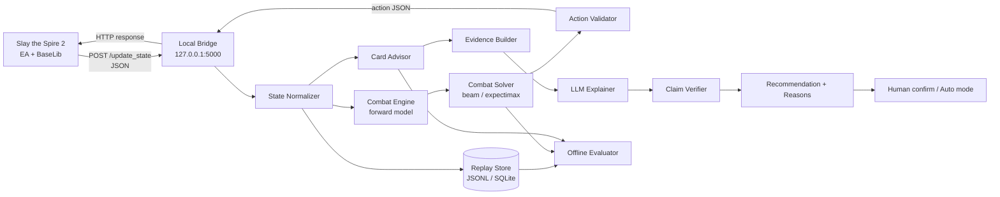

# SpirePilot：基于限定预算搜索与证据约束生成的《杀戮尖塔 2》战斗决策与选牌推荐研究

> **开题分析（Proposal）**
>
> | 项目 | 内容 |
> |---|---|
> | 项目名称 | SpirePilot（尖塔领航员，暂定名） |
> | 文档版本 | v0.1 |
> | 日期 | 2026-10-21 |
> | 研究对象 | 《杀戮尖塔 2》（Slay the Spire 2, Early Access）桌面版 |
> | 默认角色 | Ironclad（先做单角色，验证后再扩展） |
> | 默认难度 | Ascension 0–10（A0 先跑通，A10 做压力测试） |
> | 项目周期 | 12 周（单人，约 12–15 小时/周），含 1 周缓冲 |
> | 文档性质 | 课程/毕业设计开题；也可作为个人项目的技术立项书 |

---

## 摘要

《杀戮尖塔 2》是一款把战术战斗、牌组构筑与路线规划压缩在单局数十分钟内的 roguelike 卡牌游戏。它的战斗回合深度不深，但状态空间大、抽牌顺序隐藏、敌人意图部分可见，且每一次选牌都会改变后续几十层的胜率。现有工作呈现两极：规则 bot 透明、低延迟，却依赖手写启发式、缺少长期判断；端到端 LLM agent 具备丰富的先验知识和自然语言解释能力，但在高难度下仍明显落后于人类专家，且存在成本高、数值幻觉、风险偏好过于保守等问题。

本项目提出 **SpirePilot**：一个面向 StS2 的混合式决策系统。战斗内，把出牌顺序建模为部分可观测的序贯决策问题，用「可对拍的战斗前向模型 + 限定预算的 beam/expectimax 搜索 + 可调评估函数」求解近似最优动作序列；战斗后，把「三选一 + 跳过」建模为上下文感知排序问题，用牌组、遗物、幕数、Boss、血量与卡牌协同特征做推荐，并由结构化证据约束 LLM 生成原因，最后用规则校验器检查数值与机制声明。

项目不承诺「理论最优」或「全流程超越人类」，而是追求三个可验证的目标：在固定种子与固定版本上**稳定优于贪心基线**；在选牌上**提升与专家选择的一致性并给出可信理由**；在系统层面**可复现、可审计、可降级**。默认形态是人机协同的 copilot，只有在显式开启自动执行并形成闭环时，才将其视为 agent。

**关键词**：杀戮尖塔 2；序贯决策；部分可观测马尔可夫决策过程；限定预算搜索；可解释推荐；LLM agent；游戏 AI

---

## 0. 一页纸结论

### 0.1 这两个需求分别是什么

| 需求 | 输入 | 输出 | 本质 | 学术叫法 | 单独看是不是 agent |
|---|---|---|---|---|---|
| 战斗内最优出牌顺序 | 当前战斗状态、手牌、能量、敌人意图、牌堆构成 | 动作序列（出哪张、打谁、何时结束回合） | 在隐藏信息与随机性下搜一条动作序列 | 部分可观测序贯决策 / 单人随机博弈 / solver | 不是，是决策器 |
| 选牌推荐 + 原因 | 角色、当前牌组、遗物、血量、幕数、Boss、三张候选卡 | 排序、跳过建议、自然语言理由 | 对候选做上下文排序并解释 | 上下文感知推荐 / learning-to-rank / 可解释 AI | 不是，是推荐器 |
| 读状态 → 决策 → 执行 → 看反馈 → 再决策 | 上述两者 + 执行通道 | 闭环行为 | 自主 agent | 模型型效用 agent / LLM agent（若 LLM 掌决策） | 是，闭环后才算 |

**判定标准不是「有没有用 LLM」，而是三条**：是否持续感知环境、是否自主选择并执行动作、是否根据反馈修正后续决策。只输出建议、由人点击，是 copilot；自己点，是 agent；LLM 只写解释，不是 LLM agent。

### 0.2 难度判断

| 工作包 | 难度（1–5） | 主要原因 |
|---|---:|---|
| 环境接入 | 2.5 | 有 `Communication_Mod_STS2` + BaseLib 的本地 HTTP 通道；但 EA 补丁频繁，状态字段不全，奖励选择没有现成命令 |
| 战斗前向模型 | 4.5 | 截至调研，未找到成熟、可公开复用的 StS2 战斗模拟器；卡牌、遗物、能力、随机效果都要自己实现并对拍 |
| 战斗内求解 | 4 | 单回合深度浅，但评估函数、隐藏抽牌、目标选择与随机性组合起来仍很棘手 |
| 选牌推荐 | 3.5 | 目标函数随卡组/遗物/幕数变化，专家标签稀缺，存在分布偏移 |
| 原因解释 | 3 | 生成不难，**忠实**很难；必须做证据绑定与数值校验 |
| 全流程自动通关 | 5 | 地图、商店、事件、营火、Boss 预判是另一个量级的工程 |

**结论**：12 周做「单角色 + 战斗 + 卡牌奖励 + 可解释建议」的 MVP，难度中高但可行；做「全角色、全流程、稳定 A10」不现实，不应写进开题承诺。

### 0.3 三条设计原则

1. **先把评估函数和评估协议做出来，再谈搜索**。没有稳定基线，就无法判断搜索是否真的有用。
2. **LLM 不碰最终战术裁决**。战术由可复现的 solver 负责；LLM 负责把结构化证据转成自然语言，并接受校验。
3. **默认人机协同，自动执行是可选项**。这样既降低合规与误操作风险，也让「推荐 + 原因」的价值独立成立。

---

## 1. 选题背景与意义

### 1.1 游戏为什么适合作为决策研究载体

《杀戮尖塔 2》的核心循环是：选路线 → 进战斗 → 出牌 → 拿奖励/升级/买牌 → 打 Boss。它同时具备以下性质：

- **序贯性**：早期选牌决定后期上限，当前血量会影响后续是否敢打精英。
- **随机性**：抽牌顺序、敌人意图、奖励、事件都带随机。
- **隐藏信息**：玩家知道牌堆构成，但通常不知道下一张抽什么；敌人意图只部分可见。
- **组合爆炸**：手牌、能量、目标、牌堆、遗物、能力层数共同决定合法动作。
- **短回合、长牌局**：单回合通常只有 3–5 点能量、出 2–4 张牌，搜索深度浅；但一局有几十层、数百个决策，长期信用分配难。
- **可文本化**：状态与规则可以较完整地用 JSON/文本描述，适合做 LLM 与符号方法的对照实验。

这使它成为研究「短程精确搜索 + 长程模糊判断」混合决策的理想测试场。与围棋、星际等游戏相比，它的规则更接近「可读的表格与状态机」，单人项目也更容易在本地复现。

### 1.2 为什么是现在

截至 2026 年 10 月，StS2 处于 Early Access；Epoch 的 SpireClimb 基准把版本冻结在 `v0.107.1`，最高 Ascension 为 10，共有 5 名角色[1]。与此同时，三类基础设施已经成熟到可以支撑个人项目：

1. **游戏侧通信**：`Communication_Mod_STS2` 通过 BaseLib + Harmony 把战斗与非战斗状态以 JSON POST 到本地 `127.0.0.1:5000`，并可从 HTTP 响应体接收战斗动作[7][9]。
2. **社区工程**：已经出现 `sts2-mcp-bridge` 这类把 StS2 接成 MCP/自动战斗的桥接项目，说明「状态—动作」链路可行；但其 README 明确承认只端到端验证了 1 场战斗、没有胜率指标，动态费用与部分能力也未完整建模[8]。
3. **LLM 基线**：Epoch AI 的 SpireClimb 与 SpireBench 等基准，已经给出了 StS1/StS2 在最高难度下的可比数据，可作为「LLM 到底强在哪、弱在哪」的参照[1][2][3]。

这些工作解决的是「能不能接进去」和「LLM 能不能玩」，但没有解决一个更贴近玩家的问题：**能不能在具体局面下，给出可解释、可验证、比贪心更好的战术与选牌建议？** 这正是本项目的切入点。

### 1.3 现有基线透露出的关键事实

- SpireClimb 报告：前沿模型在 StS1 A0 的胜率已可达 90% 以上；但在 A20 Heart 只有约 17%–20%，而顶尖人类玩家约 85%；在 StS2 A10 上模型胜率超过 25%，仍远低于人类高手约 95% 的水平[1][2]。
- SpireBench 对 20 个 LLM 在 StS1 A20 的评测显示：前沿模型能超过规则基线和普通人类玩家，但离专家很远；**强弱模型的主要差距在每一场战斗的打法**，且所有模型都倾向于过度保守，不愿用血量换成长；跨局记忆并没有稳定带来提升[3]。
- AgenticSTS 把 StS2 作为长程 LLM agent 的测试床：在 A0 上，无记忆基线 10 局赢 3 局，加入技能层后 10 局赢 6 局，但样本量下 `p≈0.37`，只能算方向性证据[4]。
- Orak 用 MCP 把 LLM 接入 12 款游戏，证明「LLM + 工具」的通用游戏 agent 架构可行；但在 StS 类游戏里，LLM 通常只负责战斗与选牌，其余交给规则 bot，且难度与种子覆盖有限[5][3]。
- Language-Driven Play 早期就验证了 LLM 可以作为 StS 的游戏 agent，但也暴露了长程规划与数值精确性的短板[6]。

> 这些数字是 2026 年 10 月的快照。模型迭代很快，项目应把它们当作「当前参照」而不是固定靶；真正要比较的是同一版本、同一种子、同一信息条件下的系统表现。

**综合判断**：LLM 的先验知识与自然语言能力很强，但在「精确计算、风险校准、稳定复现」上不适合作为唯一决策器；经典搜索擅长战术，却缺少长程常识与解释能力。二者互补，而不是替代。

### 1.4 研究缺口

| 缺口 | 现状 | 本项目要做的事 |
|---|---|---|
| 战术求解缺少可复现的 StS2 实现 | 规则 bot 多为手写贪心；搜索型工作多依赖简化模拟器 | 建立可对拍的战斗前向模型 + 限定预算搜索，并公开评估协议 |
| 选牌建议缺少上下文与「跳过」 | 社区 tier list 多为静态排名；LLM 建议泛化但易编数值 | 把牌组、遗物、幕数、Boss、血量纳入排序，显式建模 skip |
| 解释缺少忠实性校验 | LLM 解释常「听起来对」，但数值/机制可能错 | 证据包 + 模板/LLM + 规则校验器，做 claim-level 评估 |
| 缺少可部署的 copilot | 现有项目要么是 benchmark，要么是自动 bot | 默认人机协同，支持 shadow mode 与可选自动执行 |
| 版本漂移 | EA 补丁频繁，结果难复现 | 锁定游戏/mod 版本，记录种子、配置、commit |

### 1.5 研究意义

- **学术意义**：在「短程可搜索、长程需判断」的游戏中，研究符号搜索与 LLM 的分工边界；为可解释推荐在序贯决策场景中的忠实性评估提供一个可复现案例。
- **工程意义**：产出一套可复用的 StS2 状态适配、回放、求解、推荐与评估基础设施，后续可以扩展到其他卡牌游戏。
- **实践意义**：为玩家提供「这回合怎么打、这张牌为什么拿/不拿」的透明建议，而不是一个黑箱自动通关器。
- **教学意义**：覆盖 POMDP 建模、搜索、启发式评估、学习排序、LLM 约束生成、实验设计与统计，适合作为综合型项目。

---

## 2. 国内外研究现状

本节以公开可检索的论文、基准与开源项目为主；社区攻略、tier list 与脚本作为实践基线单独讨论。国内社区在这类游戏上的实践很多，但公开、可复现、可比较的 StS2 战术求解与解释评估仍较少，这也是本项目强调「锁版本 + 固定种子 + 公开配置」的原因。

### 2.1 游戏 AI 的三条路线

#### （1）规则/符号 bot

代表工作是 Bottled AI（StS1）与 `sts2-mcp-bridge` 的内置 autopilot（StS2）。后者用伤害/费用、击杀奖励、AOE、预防性格挡、长战斗中的成长牌、毒等规则做贪心评分，并在游戏拒绝出牌时把 `NotPlayable` 写入状态，避免死循环[8]。

- 优点：透明、低延迟、无需训练、容易部署。
- 缺点：权重手调、难以覆盖组合效果；只看当前回合，缺少长期牌组价值；跨角色/跨版本泛化差；验证样本通常很小。
- 对本项目的启示：**贪心基线必须做**，它是判断搜索是否真的有增益的最低门槛。

#### （2）搜索与强化学习

经典方法把战斗视为单人随机博弈，用 expectimax、MCTS、beam search 或 RL 训练策略。MCTS 在完全信息、可快速模拟的游戏中很强[11]；RL 在 Atari/Go 等环境也证明了从零学习的可能[12]。

但 StS2 有三个现实约束：

1. **截至调研，未找到公开、忠实、可分支的模拟器**。游戏内执行动作不可逆，不能靠「试打再撤销」来搜索。
2. **部分可观测**。抽牌顺序、未来随机数未知，必须用信念状态或 determinization 近似。
3. **组合空间大、样本效率低**。全卡池、全遗物、全敌人的 RL 训练不适合 12 周单人项目。

因此，本项目不做端到端 RL，而做「自建前向模型 + 限定预算搜索 + 可调启发式评估」。这是把搜索用在最划算的地方：单回合/单场战斗的战术层。

#### （3）LLM agent

- **Language-Driven Play** 较早把 LLM 作为 StS 的 game-playing agent，验证了可行性，但也显示长程规划与精确数值是短板[6]。
- **Orak** 用 MCP 把 LLM 接入 12 款游戏，提供了通用的工具调用与评测框架；在 StS 中，LLM 主要负责战斗和卡牌奖励，其余由规则 bot 完成，难度与种子覆盖有限[5][3]。
- **AgenticSTS** 把 StS2 作为「有界记忆」的长程 agent 测试床，说明即使把记忆结构化，A0 胜率仍不高，且小样本下差异不显著[4]。
- **SpireBench** 系统评测 20 个 LLM 在 StS1 A20 的表现，发现它们能超过普通人类但远逊专家；战斗打法比宏观决策更能区分强弱；模型普遍过度保守；跨局记忆没有稳定收益[3]。
- **SpireClimb** 用视觉 computer-use 接口评测两个游戏，给出了目前较完整的最高难度胜率参照[1][2]。

- 优点：自带游戏常识、能处理未见过的情况、天然可解释、开发速度快。
- 缺点：成本高、延迟高、数值/机制幻觉、随机性下不稳定、难以保证合法动作、容易被「听起来合理」的解释误导。
- 对本项目的启示：**LLM 适合做解释器与长程先验，不适合单独做战术最优解**。

### 2.2 选牌推荐的研究现状

社区最常见的做法是静态 tier list：按卡牌强度、流派、版本给一个 S/A/B 等级。它的问题是：

- 不考虑当前牌组：同一张「祭品」在飞刀流和毒流里价值相反。
- 不考虑遗物与 Boss：某些卡在特定遗物/敌人面前价值剧变。
- 不考虑机会成本：拿一张牌意味着稀释牌组、错过跳过。
- 不解释「为什么现在不拿」：多数工具只推荐拿什么，不推荐跳过。

学术上，这可以建模为上下文感知排序（context-aware ranking）或学习排序（learning-to-rank）：输入是「局面 + 候选卡」，输出是排序。挑战在于标签：什么算「正确」的选牌？专家选择只是一个有噪声的代理；用胜率做反事实评估又依赖模拟器。已有推荐系统研究提供了特征工程、 pairwise ranking、校准等方法，但 StS2 场景的**长程信用分配**与**版本漂移**需要专门处理。

### 2.3 可解释 AI 的现状

可解释推荐通常分三类：基于特征归因（为什么推荐这张）、基于反事实（如果不选它会怎样）、基于自然语言（用话说明）。LLM 让第三类变得便宜，但也带来「看似合理、实则不忠实」的问题。已有研究强调 **faithfulness（忠实性）** 与 **plausibility（可信度）** 的区别：解释听起来越顺，不一定越能反映模型的真实依据。

本项目不追求「让 LLM 自由解释」，而是：

1. 先由推荐器产生结构化依据（特征贡献、相似对局、模拟差值）。
2. LLM 只把这些依据转成自然语言。
3. 校验器逐条检查数值、卡名、机制与证据引用。
4. 校验失败则降级为模板解释，并标注不确定性。

### 2.4 研究缺口总结

| 能力 | 规则 bot | 端到端 LLM | 现有 benchmark | 本项目 |
|---|---|---|---|---|
| 单回合精确战术 | 中（手写规则） | 中低（数值不稳） | 只评测，不产出 | **高（搜索 + 前向模型）** |
| 长程选牌判断 | 低 | 中（有先验） | 只评测 | **中高（上下文排序）** |
| 解释可读性 | 低 | 高 | 不涉及 | **高（LLM 生成）** |
| 解释忠实性 | 高（规则即解释） | 低（易幻觉） | 不涉及 | **中高（证据 + 校验）** |
| 可复现评估 | 低 | 低 | 高 | **高（锁版本 + 固定种子）** |
| 可部署 copilot | 中 | 低（成本/延迟） | 不涉及 | **高（本地 + 可降级）** |

---

## 3. 研究问题、假设与目标

### 3.1 总目标

构建一个面向 StS2 单角色（Ironclad）的本地决策支持系统，能够在战斗内给出近似最优的出牌序列，在战斗后给出上下文感知的选牌排序与可信解释，并在固定版本、固定种子上完成可复现的对照评估。

### 3.2 研究问题

**RQ1（战术层）**：在单场战斗、给定牌组/遗物/敌人意图的条件下，使用自建前向模型与限定预算搜索，能否在固定种子集上稳定优于贪心与单步基线，并缩小与穷举最优的差距？

**RQ2（战略层）**：把选牌建模为「三选一 + 跳过」的上下文排序问题，引入牌组协同、费用曲线、遗物、幕数/Boss 与冗余度特征，能否提升与专家选择的一致性，并在模拟中带来胜率或血量增益？

**RQ3（解释层）**：用结构化证据约束 LLM 生成理由，并做 claim-level 校验，能否在保持可读性的同时显著降低数值/机制错误？

### 3.3 研究假设

- **H1**：在相同评估预算下，2-ply/beam 搜索 + rollout 评估比「贪心 + 单步」平均少掉血，并在固定战斗集上提高胜率。
- **H2**：加入上下文特征与 skip 选项的排序器，比静态 tier list/仅卡牌强度基线有更高的 top-3 专家一致率。
- **H3**：证据包 + 校验器能把解释中的「无依据数值声明」比例降到可接受水平，且不会显著降低人类可读性评分。

> 这些假设都可能被证伪。**负结果同样有价值**：如果搜索打不过贪心，说明评估函数或前向模型是瓶颈；如果排序器打不过 tier list，说明数据/特征不足。开题报告应预先写清楚「什么情况下承认失败」。

### 3.4 研究边界

**术语约定**：本项目的「选牌」特指战斗后的卡牌奖励三选一 + 跳过；战斗内「这一回合出哪张牌」属于战斗求解，不重复计入选牌推荐。

**做**：

- Ironclad 单角色；A0 先跑通，A10 做压力测试。
- 单场战斗内的出牌、目标选择、结束回合。
- 战斗后的卡牌奖励三选一 + 跳过。
- 本地 copilot（建议 + 人工执行）；可选自动执行战斗。
- 固定版本、固定种子的离线评估与回放。

**不做**：

- 读屏、读内存、注入未公开接口。
- 地图路径规划、商店、事件、营火、Boss 预判的全自动。
- 全角色、全卡池、全遗物的完整覆盖。
- 排行榜、成就、联机成绩上传。
- 承诺「理论最优」或「超越顶尖人类」。

---

## 4. 问题定义与形式化

### 4.1 战斗内决策：部分可观测序贯决策

把一场战斗建模为 POMDP：

$$
\mathcal{M} = (\mathcal{S}, \mathcal{A}, T, R, \Omega, O, \gamma)
$$

- **状态** $s_t$：玩家血量/最大血量、格挡、能量、能力层数、手牌、抽牌堆（多重集）、弃牌堆、消耗堆、遗物、药水、敌人血量/格挡/能力/意图、回合数、随机数状态等。
- **动作** $a_t$：`PlayCard(hand_index, target_index)` 或 `EndTurn`。MVP 不含药水使用。
- **转移** $T(s_{t+1}\mid s_t,a_t)$：卡牌效果、敌人行动、抽牌与随机效果共同决定。
- **观测** $o_t$：玩家可见的信息。抽牌顺序、未来随机数、部分意图不可见。
- **信念** $b_t(s)$：对隐藏状态的分布。工程上用「已知牌堆多重集 + 抽牌顺序采样」近似。
- **奖励** $R$：战斗胜利、剩余血量、资源消耗、回合数等。可采用「胜利 + 血量形」的标量化，或把血量作为约束。

**目标**：

$$
\pi^* = \arg\max_{\pi} \mathbb{E}\left[\sum_{t=0}^{T} \gamma^t R_t \mid b_0\right]
\quad \text{s.t.} \quad \text{decision budget} \le B
$$

**“最优”的严格含义**：在信息集（information set）意义下、在给定计算预算 $B$ 内、对随机性取期望的最优，而不是「上帝视角知道下一张牌」的确定最优。实际报告时使用「近似最优 / budget-constrained optimal」这一表述。

**为什么单回合深度浅**：通常 3–5 点能量，每张牌 0–3 费，一回合出 2–4 张；即使考虑 0 费与抽牌，动作序列长度也有限。因此搜索可以把重点放在「动作顺序 + 目标 + 是否结束回合」，而不是展开到整场战斗。

### 4.2 选牌推荐：上下文排序

给定上下文 $c$（角色、牌组、遗物、血量、金币、幕数、楼层、Boss、Ascension、近期选择）与候选集合

$$
\mathcal{C} = \{ \text{card}_1, \text{card}_2, \text{card}_3, \text{skip} \},
$$

学习一个效用函数 $U(c, x)$，输出排序与置信度：

$$
\hat{x} = \arg\max_{x \in \mathcal{C}} U(c, x).
$$

**标签从哪来**：

- 专家/高分玩家的实际选择（主标签，但有噪声与风格偏差）。
- 反事实模拟：把候选卡加入牌组，用固定策略跑若干战斗，比较胜率/血量（贵，且依赖模拟器）。
- 人类偏好研究：小样本，用于解释可用性而非真值。
- 规则先验/社区 tier list：冷启动基线，需标注来源与版本。

**难点**：同一张卡的价值依赖牌组与未来路线；「跳过」是合法且经常正确的动作；版本更新会改变卡牌价值。项目必须显式建模 skip，并按 run/seed 划分训练/测试，避免同一局的选择泄漏。

### 4.3 “是不是 agent”的系统分层

按照经典 AI 教材的定义，agent 通过传感器感知环境、通过执行器作用于环境，并在目标驱动下选择行动[10]。因此「是否使用 LLM」不是判据，**是否形成自主的感知—决策—执行—反馈闭环**才是。

| 层级 | 形态 | 谁执行动作 | 是否有闭环 | 本项目 |
|---|---|---|---|---|
| L0 | 分析工具/可视化 | 人 | 否 | 可选 |
| L1 | 单步建议 | 人 | 否 | 战斗/选牌建议的最小形态 |
| L2 | Copilot：连续建议 + 人确认 | 人 | 半闭环（人反馈） | **默认形态** |
| L3 | 自动执行 + 状态反馈 | 系统 | 是 | 可选，仅战斗 |
| L4 | LLM 掌决策 + 工具调用 | LLM + 系统 | 是 | 不做主路径 |

因此，**本项目的主体是 L2**。当且仅当开启 L3 的战斗自动执行时，系统满足「感知—决策—执行—反馈」的 agent 定义；但它的战术核心仍是 solver，而不是 LLM，所以应称为「agentic system」而非「LLM agent」。

---

## 5. 研究内容与技术路线

### 5.1 工作包（WP）

| 编号 | 工作包 | 主要产出 | 关键风险 |
|---|---|---|---|
| WP1 | 环境接入与数据采集 | 本地 bridge、状态规范化、回放库、卡牌/遗物/敌人数据库 | EA 补丁、字段缺失、奖励选择无命令 |
| WP2 | 战斗前向模型 | 可执行的卡牌/状态/敌人效果模拟器；与游戏对拍的金标轨迹 | 机制覆盖不全、随机性建模偏差 |
| WP3 | 战斗求解器 | 合法动作枚举、beam/expectimax、评估函数、时间预算控制 | 评估函数难调、搜索爆炸 |
| WP4 | 选牌推荐器 | 特征管道、排序模型、skip、校准 | 专家标签稀缺、分布偏移 |
| WP5 | 解释与校验 | 证据包、模板/LLM 生成、claim 校验器 | 幻觉、解释冗长、忠实性难评 |
| WP6 | 系统集成与评估 | CLI/本地界面、shadow mode、离线/在线实验、报告 | 时间不足、样本量不够 |

### 5.2 系统架构



**在线闭环（可选自动战斗）**：

1. 游戏在 `OnTurnStarted`、`OnCombatHistoryChanged` 等触发点推送状态。
2. Bridge 规范化状态，调用 solver 产生**一个**动作。
3. 动作 JSON 作为 HTTP 响应体返回；游戏执行后再次推送新状态。
4. 若动作被拒绝或状态未变化，记录 rejection，重新规划；连续失败则降级为 `EndTurn` 并告警。

**离线评估**：

1. 从回放库读取固定种子/战斗。
2. 用前向模型从同一初始状态出发，分别跑贪心、单步、beam、LLM 基线。
3. 对齐游戏真实轨迹，计算动作一致率、掉血、胜率、延迟、非法动作率。
4. 输出可复现的实验报告。

### 5.3 战斗求解器

#### 动作枚举

- 手牌中每张可打出的牌 × 每个合法目标。
- `EndTurn`。
- 过滤：能量不足、目标不存在、牌不可打出、已触发过的不能重复触发。
- 对 0 费/抽牌/免费攻击等特殊情况单独处理，避免无限循环。

#### 搜索

- **回合内**：DFS/beam，状态包括手牌多重集、能量、玩家/敌人状态、已打出牌、抽牌堆剩余。用规范化 key 做置换表。
- **抽牌随机**：对抽牌堆做 K 次 determinization（按已知多重集采样顺序），每次搜索后对结果取平均；K 随剩余时间自适应。
- **跨回合**：只做 1–2 回合 lookahead；敌人意图已知时，把敌人回合视为确定性（或小范围随机）转移；不展开整场战斗。
- **叶子评估**：线性特征 + rollout 到本回合结束/敌人回合结束，取期望。
- **时间预算**：默认 1–2 秒/动作；超时降级为贪心，保证不卡住游戏。

#### 评估函数（初版）

| 维度 | 特征示例 | 方向 |
|---|---|---|
| 致命性 | 本回合可造成的最大伤害 vs 敌人剩余血量 | 击杀 > 一切 |
| 生存 | 预计受到伤害、格挡溢出、血量缓冲 | 减少有效掉血 |
| 节奏 | 每能量伤害/格挡、出牌数、抽牌数 | 高效利用能量 |
| 成长 | 力量/敏捷/集中/毒/充能球/能力的每回合价值 | 长战斗加权 |
| 资源 | 药水、消耗、牌堆质量、下回合手牌 | 保留关键资源 |
| 风险 | 随机效果方差、下回合被秒概率 | 风险调整 |

权重先用专家直觉设定，再用交叉熵方法（CEM）或随机搜索在训练战斗集上调；测试集不参与调参。若时间允许，再尝试小型价值网络，但不作为 MVP 必要条件。

#### 伪代码

```text
function decide(state, budget):
    actions = legal_actions(state)
    if lethal_exists(actions): return lethal_action
    best = null
    for determinization in sample_draw_orders(state, K):
        root = canonical(state, determinization)
        value = beam_search(root, depth=2, width=W, deadline=budget)
        best = argmax(best, value)
    return best.action or EndTurn
```

### 5.4 选牌推荐器

#### 特征

- **卡牌本身**：费用、类型（攻击/技能/能力）、稀有度、基础数值、升级收益、条件性、消耗/ exhaust、抽牌/能量。
- **牌组**：大小、攻击/技能/能力比例、费用曲线、升级比例、抽牌密度、能量密度、已有协同标签、冗余度。
- **遗物**：与卡牌标签的交互（如力量、毒、充能球、格挡、消耗）。
- **局面**：角色、Act/Floor、Boss、Ascension、当前血量/最大血量、金币、药水。
- **长期**：当前 Act 的即时战力 vs 后期上限；牌组是否已经「过厚」；是否需要针对 Boss 的解答牌。
- **先验**：社区 tier list/统计先验（标注来源与版本，作为特征而非真理）。

#### 模型

- 基线 1：静态分数（卡牌强度 + 少量协同）。
- 基线 2：逻辑回归/线性打分（可解释）。
- 主模型：LambdaMART/LightGBM ranker 或 pairwise logistic，输出分数与校准置信度。
- `skip` 作为候选，分数为 0 或学习得到的阈值；当最高分低于阈值时建议跳过。
- 数据不足时，退回「规则 + 专家先验」，不强行训练。
- 可选：用 LLM 生成「这张卡在当前牌组中的角色」作为特征或提示，但必须记录 prompt 与输出来源，且不直接决定排序；无法验证时关闭。

#### 评估

- 与专家选择的 top-1/top-3 一致率。
- NDCG@3（把专家选择视为相关）。
- skip 的精确率/召回率。
- 校准误差（置信度 vs 实际一致率）。
- 反事实模拟：按推荐选牌 vs 按基线选牌，比较后续战斗胜率/血量（需注明模拟器依赖）。
- 人类盲测：5–10 名玩家，A/B 对比理由的有用性。

### 5.5 解释生成与校验

#### 证据包

```json
{
  "recommendation": {"card_id": "ANGER", "action": "take", "confidence": 0.71},
  "evidence": [
    {"id": "deck:size", "text": "当前牌组 24 张，攻击牌偏多", "value": 24},
    {"id": "deck:synergy", "text": "已有 2 张力量牌， Anger 的重复攻击可受益", "value": 2},
    {"id": "sim:delta", "text": "加入后模拟 20 场，平均少掉 3.2 血", "value": -3.2},
    {"id": "risk:act2", "text": "第二幕多群体战，单体重击价值下降", "value": "negative"}
  ],
  "caveats": ["样本量小，模拟器未覆盖所有遗物"]
}
```

#### 生成

- 模板优先：结构化证据 → 固定句式，保证 100% 可控。
- LLM 增强：把证据包转成自然语言，要求「每个数字必须来自 evidence，不得新增数值；每个协同声明必须引用 evidence id」。
- 输出 schema：推荐、置信度、2–3 条理由、1 条风险/替代方案、证据引用。

#### 校验

- 卡名/ID 必须存在于当前版本数据库。
- 数值必须与数据库/模拟结果一致（容差 0）。
- 机制声明必须能映射到卡牌文本或遗物文本。
- 不允许出现「胜率提升 X%」除非有对应实验结果。
- 校验失败 → 回退模板，并记录失败原因，用于迭代 prompt。

### 5.6 关键技术难点与应对

| 难点 | 为什么难 | 应对 |
|---|---|---|
| 前向模型保真 | 卡牌效果、遗物、能力、随机交互多；EA 还在改 | 先覆盖 Ironclad + 第一幕常见卡/敌人；金标对拍；未覆盖卡走保守回退 |
| 隐藏抽牌 | 不知道下一张；搜索会分叉 | 多重集采样 K 次 determinization；报告 K 的敏感性 |
| 评估函数 | 「一张祭品值多少」没有标准答案 | 线性特征 + CEM 调参 + 消融；用掉血/胜率做外部验证 |
| 选牌标签 | 专家选择有噪声；反事实贵 | 小规模专家数据 + 规则先验 + 人类研究；不夸大 |
| 解释忠实 | LLM 容易编 | 证据包 + schema + 校验器 + 模板回退 |
| 评估方差 | 单局随机大 | 固定种子、足够样本、置信区间、预注册指标 |

### 5.7 研究方法

| 方法 | 用在哪 | 具体做法 |
|---|---|---|
| 文献与工具调研 | 选题、现状 | 读论文/基准/源码，核实 StS2 的工具链与版本 |
| 设计科学（design science） | 系统构建 | 迭代「问题—设计—实现—评估」，每轮留可复现产物 |
| 形式化建模 | 战斗/选牌 | POMDP、上下文排序、效用函数；先写定义再写代码 |
| 离线仿真实验 | 战术/选牌 | 固定种子、配对比较、消融、置信区间 |
| 对照实验 | 基线对比 | 贪心/单步/LLM/静态 tier list，同状态同预算 |
| 误差分析 | 前向模型 | 金标轨迹逐步对拍，分类模型 bug/未支持/导出缺失 |
| 用户研究 | 解释/推荐 | 5–10 人盲测，Likert + 偏好 + 访谈；明确样本局限 |
| 负结果分析 | 全流程 | 若假设不成立，定位是模型、搜索、数据还是评估问题 |

---

## 6. 创新点

创新点保持克制，避免把「工程整合」包装成「理论突破」：

1. **面向 StS2 EA 的「可对拍前向模型 + 限定预算搜索」组合**：不是简单调 API，而是把战斗规则、随机性与评估函数拆开，能定位误差来自模型还是搜索。
2. **上下文感知的选牌排序 + 显式 skip**：把「拿哪张」扩展为「拿/不拿」，并把牌组协同、遗物、Boss、幕数纳入同一排序框架。
3. **证据约束的解释与 claim-level 校验**：LLM 不自由发挥，而是把结构化证据转成自然语言；校验失败可降级，解释可审计。
4. **可复现的 StS2 评估协议**：锁定游戏/mod 版本，固定种子，公开配置与回放格式，报告置信区间与负结果。

如果只能保留一个亮点，建议保留 **（1）+（3）**：前者是战术价值，后者是可信度；选牌推荐可以后置。

---

## 7. 可行性分析

### 7.1 技术可行性

| 条件 | 现状 | 判断 |
|---|---|---|
| 状态/动作通道 | `Communication_Mod_STS2` 已提供本地 HTTP；命令支持 `PlayCard`/`EndTurn` | 可行；需处理响应体格式、索引变化、拒绝 |
| 非战斗状态 | 可读取奖励/商店/地图/营火/事件/库存 | 可行；奖励选择命令需人工或扩展 mod |
| 卡牌数据 | mod 导出部分字段；卡牌文本/稀有度/标签不全 | 需自建数据库；单角色可控 |
| 模拟器 | 截至调研，未找到成熟、可公开复用的 StS2 战斗模拟器 | 最大工作量；需限定范围并对拍 |
| 计算资源 | 笔记本 CPU 即可；搜索是毫秒–秒级 | 可行；不需要 GPU |
| LLM | 可选 API 或本地模型；只用于解释 | 可行；成本可控 |

### 7.2 数据可行性

- **战斗回放**：自己玩/自动跑，记录 JSONL；最容易获得。
- **选牌标签**：专家数据最难。MVP 先用自己的对局 + 少量招募玩家；不承诺大规模学习排序。
- **卡牌/遗物/敌人数据**：从游戏本地化文件、mod 导出或 wiki 整理；需记录来源与版本。
- **合规**：不抓取未授权数据；不传播游戏资源；引用 wiki 时遵守其许可。

### 7.3 时间可行性

12 周、每周 12–15 小时，约 150–180 小时。按工作包粗分：

| 工作包 | 预估工时 | 占比 |
|---|---:|---:|
| 环境/数据/卡牌库 | 30–35 h | 20% |
| 前向模型 | 35–45 h | 25% |
| 求解器/评估 | 30–35 h | 20% |
| 选牌推荐 | 20–25 h | 14% |
| 解释/校验 | 15–20 h | 11% |
| 集成/评估/写作 | 20–25 h | 14% |

这个预算**只够单角色 MVP**。如果要做全角色/全流程，至少翻倍。

### 7.4 为什么不是纯 LLM / 纯 RL

| 方案 | 优势 | 为什么不选为主路径 |
|---|---|---|
| 纯 LLM | 开发快、解释好、常识强 | 高难度战术不稳、成本/延迟高、数值幻觉、难复现 |
| 纯 RL | 理论上可端到端优化 | 缺可复用模拟器、样本效率低、12 周不可行、解释差 |
| 纯规则 bot | 简单、透明 | 上限低、难覆盖组合、缺少长期判断 |
| **混合** | 搜索负责战术、LLM 负责解释、排序器负责长期 | 工程复杂度可控，且每一层都可单独评估 |

### 7.5 风险后的可行性结论

**可行**，但前提是：

- 接受「单角色 + 单场战斗 + 卡牌奖励」的 MVP；
- 接受「近似最优」而不是「理论最优」；
- 接受「前向模型覆盖不全」并用回退策略；
- 接受「选牌数据不足」时以规则先验为主；
- 把「自动打完整局」排除在 12 周承诺之外。

---

## 8. 评估方案

### 8.1 基线

| 层级 | 基线 | 作用 |
|---|---|---|
| 战斗 | 随机合法动作 | 下限 |
| 战斗 | 贪心（伤害/格挡/击杀） | 最强的手写基线，必须打过的对象 |
| 战斗 | 单步 lookahead | 判断「多想一步」是否有用 |
| 战斗 | beam/expectimax（本项目） | 主方法 |
| 战斗 | LLM zero-shot（同状态） | 对照「常识 vs 搜索」 |
| 选牌 | 静态 tier list | 社区常见基线 |
| 选牌 | 仅卡牌强度分 | 去掉上下文特征 |
| 选牌 | 本项目排序器 | 主方法 |
| 解释 | 纯模板 | 忠实性上限、可读性下限 |
| 解释 | 无约束 LLM | 对照幻觉率 |

### 8.2 指标

**战斗**：

- 固定种子下的战斗胜率（主要）。
- 平均剩余血量/平均掉血（主要）。
- 平均回合数、药水使用率。
- 非法动作率、超时率、拒绝率。
- 决策延迟 P50/P95。
- 小状态上的最优性差距（用穷举 DFS 做 ground truth）。
- 与人类回放的动作一致率（辅助，不作为唯一指标）。

**选牌**：

- top-1/top-3 与专家选择一致率。
- NDCG@3。
- skip 的精确率/召回率/F1。
- 置信度校准（ECE/Brier）。
- 反事实模拟的胜率/血量增益（注明模拟器依赖）。
- 人类盲测的有用性/可信度评分。

**解释**：

- claim-level factual accuracy（数值/机制/卡名）。
- 证据引用覆盖率。
- 无依据声明比例。
- 人类可读性、简洁性、有用性（5 点 Likert）。
- 反事实忠实性：移除关键证据后，推荐是否变化（若不变，说明解释可能不忠实）。

### 8.3 实验协议

1. **锁定版本**：记录游戏版本（如 `v0.107.1`）、mod commit、BaseLib 版本、Python 依赖。
2. **固定种子**：训练/验证/测试按 run/seed 划分；测试种子不参与调参。若 mod 不导出种子，至少记录初始状态 hash 做配对，并明确不能称「固定种子」。
3. **样本量**：MVP 至少 30 场战斗/条件、10 局完整 Act 1；报告 95% 置信区间。小样本明确标注「方向性证据」。
4. **预注册**：先写主指标与成功阈值，再看结果，避免事后挑指标。
5. **消融**：
   - 搜索深度/宽度。
   - determinization 次数 K。
   - 评估特征组（去掉成长/风险/资源）。
   - 选牌特征组（去掉遗物/ Boss/ skip）。
   - 解释校验器（开/关）。
6. **失败分析**：按敌人、卡组 archetype、Act、死亡原因分类；记录典型失败局面。
7. **可复现**：一键跑离线评估；输出 CSV/图表；随机种子固定。

### 8.4 成功阈值（建议，需基线测量后校准）

| 指标 | MVP 目标 | 说明 |
|---|---|---|
| 战斗胜率（A0，固定 30 场） | ≥ 贪心 + 10 个百分点 | 若基线本身很高，改为掉血显著更低 |
| 平均掉血 | 比贪心低 ≥ 15% | 需控制敌人组合 |
| 非法动作/软锁 | 0 | 硬性 |
| 决策延迟 P95 | ≤ 2 s | 可配置 |
| 选牌 top-3 | ≥ 静态 tier list + 10 个百分点 | 专家标签足够时 |
| skip F1 | ≥ 0.6 | 先看数据分布 |
| 解释数值准确率 | ≥ 95% | 硬性 |
| 解释无依据声明 | ≤ 5% | 人工抽检 |

> 这些数字是**项目目标**，不是文献结论。开题答辩时应说明「如果达不到，如何解释与调整」。

---

## 9. 预期成果

1. **可运行系统**：本地 bridge + 战斗 solver + 选牌推荐 + 解释器 + CLI/轻量界面。
2. **数据与知识库**：Ironclad 卡牌/遗物/敌人子集；JSONL 回放；固定种子清单。
3. **评估报告**：与贪心/单步/LLM/静态 tier list 的对照；消融；失败案例分析。
4. **开源仓库**（自己的代码 MIT；上游 mod 不作为本项目再分发）。
5. **演示材料**：3–5 分钟视频；一页纸架构图；答辩 slides。
6. **论文/报告**：可投课程/本科毕设；若结果扎实，可整理为 workshop paper。

---

## 10. 风险与合规

### 10.1 风险登记

| 风险 | 概率 | 影响 | 触发信号 | 缓解 |
|---|---|---|---|---|
| EA 补丁导致 mod 失效 | 高 | 高 | 游戏更新后状态为空/报错 | 锁版本；适配层隔离；每日 smoke test；保留旧版回放 |
| 卡牌数据不全 | 高 | 高 | 关键卡无文本/费用/标签 | 先做 Ironclad 子集；扩展 scanner 导出字段；未覆盖卡回退 |
| 前向模型与游戏不一致 | 高 | 高 | 模拟结果与真实轨迹偏差大 | 金标对拍；逐卡单测；记录不支持效果；保守回退 |
| 奖励选择无命令 | 中 | 中 | 只能读不能选 | 默认人工点击；或本地扩展 mod（不再分发） |
| 专家选牌数据不足 | 高 | 中 | 标签 < 200 条 | 规则先验 + 小样本；人类研究；不强行训练 |
| LLM 解释幻觉 | 中 | 高 | 数值/机制错误 | 证据包 + 校验器 + 模板回退 |
| 评估方差大 | 中 | 中 | 置信区间过宽 | 固定种子；增加样本；配对比较 |
| 时间超支 | 中 | 高 | 第 6 周仍未跑通搜索 | MVP gate；砍掉学习排序/自动执行 |
| 合规问题 | 低 | 高 | 涉及排行榜/成就/再分发 | 本地单机；不传播资源；不碰排名 |

### 10.2 合规底线

- 仅在本地单机环境使用；不上传排行榜、成就、联机成绩。
- 不使用读屏/读内存/未公开接口；只通过官方 mod 加载与本地回环 HTTP。
- 上游 `Communication_Mod_STS2` 未见明确开源许可证，按其仓库说明属于“无明确许可”；**不复制、不再分发**其代码/二进制/游戏资源。
- 不抓取未授权的专家对局或付费数据；使用自己录制的对局或取得许可的数据。
- 不在仓库中提交 API key、游戏存档、个人身份信息。

---

## 11. 进度概览

| 阶段 | 周次 | 目标 | Gate |
|---|---|---|---|
| P0 环境审计 | W0（3 天） | 跑通状态接收与一个动作；抓 20 条状态 | 能稳定执行 `PlayCard`/`EndTurn` |
| P1 数据与卡牌库 | W1–W2 | bridge、规范化、回放、Ironclad 卡牌库 v0 | 30 条回放可重放 |
| P2 前向模型 | W2–W4 | 核心卡牌/状态/敌人效果；金标对拍 | 20 条轨迹误差可解释 |
| P3 战斗 solver | W4–W6 | 贪心基线、beam v1、评估函数 | 固定战斗集上优于贪心 |
| P4 选牌推荐 | W6–W8 | 特征、排序器、skip、解释模板 | top-3 优于静态基线 |
| P5 解释与集成 | W8–W10 | 证据包、LLM、校验器、CLI/copilot | 数值准确率 ≥ 95% |
| P6 评估与写作 | W10–W12 | 消融、用户研究、报告、demo | 可复现 + 文档完整 |

详细到周的任务、依赖与验收标准见 [项目规划](02-项目规划.md)。

---

## 12. 参考文献

[1] Epoch AI. *SpireClimb*. 2026. https://epoch.ai/benchmarks/spireclimb （访问于 2026-10-21）

[2] Ou, B., & Chen, S. *AI systems are improving rapidly at Slay the Spire and its sequel*. Epoch AI, 2026-10-14. https://epoch.ai/publications/ai-systems-are-improving-rapidly-at-slay-the-spire-and-its-sequel

[3] Lowe, S. C., & Keemink, S. W. *SpireBench: Evaluating Long-Horizon Strategic Play of Agentic Models with Slay the Spire*. arXiv:2610.12596, 2026. https://arxiv.org/abs/2610.12596

[4] Cheng, X., Jiang, Y., Sun, J., et al. *AgenticSTS: A Bounded-Memory Testbed for Long-Horizon LLM Agents*. arXiv:2607.02255, 2026. https://arxiv.org/abs/2607.02255

[5] Park, D., Kim, M., Choi, B., et al. *Orak: A Foundational Benchmark for Training and Evaluating LLM Agents on Diverse Video Games*. arXiv:2506.03610, 2026. https://arxiv.org/abs/2506.03610

[6] Bateni, B., & Whitehead, J. *Language-Driven Play: Large Language Models as Game-Playing Agents in Slay the Spire*. ACM, 2024. https://doi.org/10.1145/3649921.3650013

[7] Manuelbbl. *Communication_Mod_STS2*. GitHub. https://github.com/Manuelbbl/Communication_Mod_STS2

[8] brmarcosbr. *sts2-mcp-bridge*. GitHub. https://github.com/brmarcosbr/sts2-mcp-bridge

[9] Alchyr. *BaseLib-StS2*. GitHub. https://github.com/Alchyr/BaseLib-StS2

[10] Russell, S., & Norvig, P. *Artificial Intelligence: A Modern Approach* (4th ed.). Pearson, 2021.

[11] Browne, C. B., Powley, E., Whitehouse, D., et al. *A Survey of Monte Carlo Tree Search Methods*. IEEE Transactions on Computational Intelligence and AI in Games, 4(1): 1–43, 2012.

[12] Sutton, R. S., & Barto, A. G. *Reinforcement Learning: An Introduction* (2nd ed.). MIT Press, 2018.

---

## 附录 A：术语表

| 术语 | 含义 |
|---|---|
| POMDP | 部分可观测马尔可夫决策过程；状态不完全可见，用信念分布决策 |
| Determinization | 把隐藏信息采样成若干个完全可观测的实例，分别求解后平均 |
| Beam search | 每层只保留得分最高的 W 个候选，控制搜索宽度 |
| Expectimax | 在随机节点上取期望、在决策节点上取最大的搜索 |
| Rollout | 从某状态用快速策略模拟到终止，用结果估计价值 |
| Learning-to-rank | 用机器学习学习候选排序，而不是单点分类 |
| Faithfulness | 解释是否真实反映决策依据，而非只是听起来合理 |
| Calibration | 置信度与实际正确率的一致性 |
| Copilot | 人机协同，系统建议、人执行 |
| Agent | 能感知环境、自主决策并执行、根据反馈调整的系统 |

## 附录 B：答辩预设问题

1. **“最优”怎么定义？你能证明最优吗？**
   不能证明全局最优。项目定义的是「信息集下、限定预算内的近似最优」，并会在小状态上用穷举给出最优性差距，在大状态上用固定种子胜率/掉血做外部验证。

2. **为什么不用纯 LLM？现在前沿模型已经能赢 A20 了。**
   前沿模型在 A20 的胜率约 17%–20%，远低于专家 85%；且成本、延迟、数值幻觉、复现性都不适合作为本项目的核心。LLM 在本项目里负责解释与先验，不负责战术裁决。

3. **为什么不用 RL？**
   未找到成熟、可公开复用的 StS2 战斗模拟器；RL 样本效率低，12 周单人无法覆盖全卡池；而且 RL 的策略难以解释。搜索 + 评估函数是更划算的切入。

4. **没有专家选牌数据，怎么评估推荐？**
   MVP 用规则先验 + 小规模自采数据 + 人类盲测；反事实模拟作为辅助证据。会明确报告样本量与置信区间，不把「与专家一致」等同于「正确」。

5. **LLM 编数值怎么办？**
   证据包只提供结构化事实；LLM 被要求引用 evidence id；校验器逐条检查卡名、数值、机制；失败则回退模板。评估时统计 claim-level accuracy。

6. **和前人的 MCP/bot 有什么区别？**
   现有工作主要是「接进去」或「自动打」；本项目做「可解释的战术求解 + 上下文选牌 + 忠实性评估」，并公开可复现的评估协议。

7. **12 周做得完吗？**
   只做单角色 MVP：战斗 + 卡牌奖励 + 建议，不做全流程。第 6 周设 gate；若搜索未跑通，就砍掉学习排序与自动执行，保留规则推荐与解释。

8. **自动打牌是否违规？**
   本地单机、不碰排行榜/成就/联机；不读屏/内存；不再分发上游 mod。若平台规则变化，立即停止自动执行，仅保留离线分析。

---

> **文档状态**：初稿。下一步是在真实环境中验证 `Communication_Mod_STS2` 的字段、命令与版本兼容性；验证结果将回写本文件与 [LOG.md](LOG.md)。
