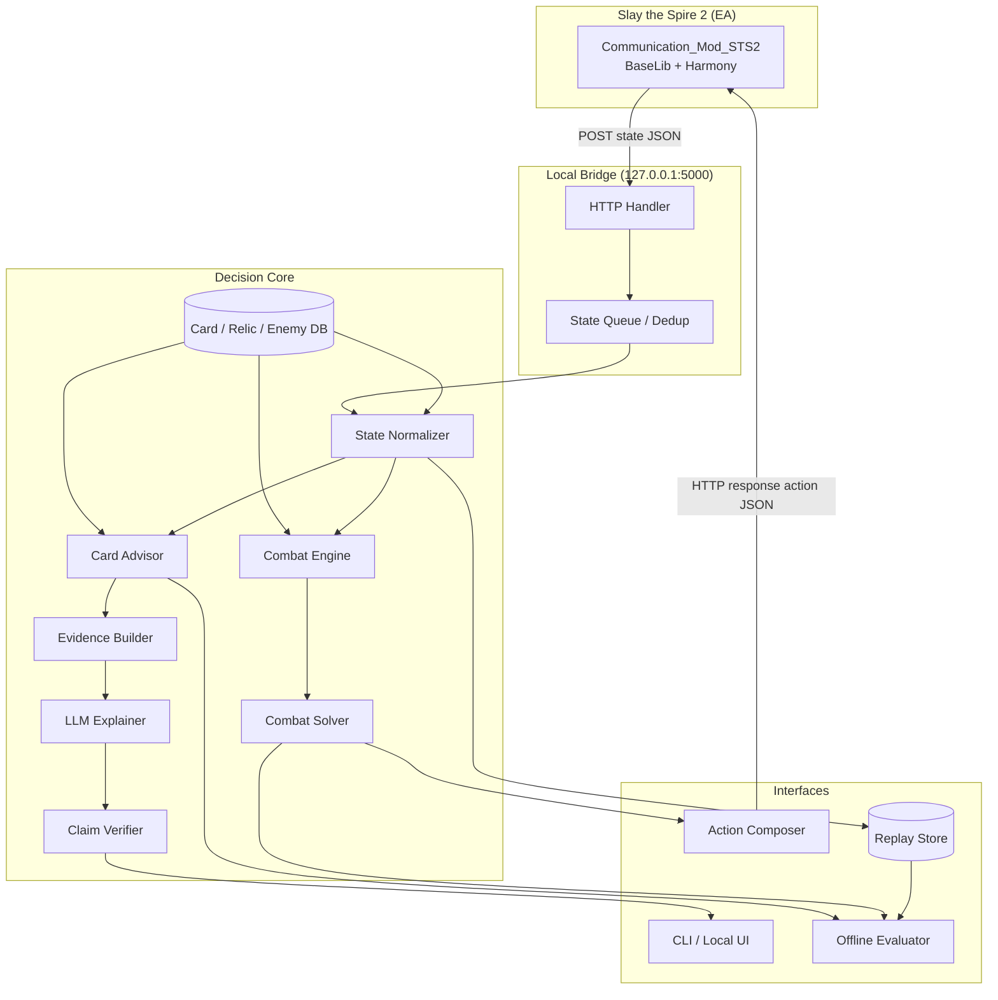

# SpirePilot 项目规划

> **执行版项目计划（Project Plan）**
>
> | 项目 | 内容 |
> |---|---|
> | 文档版本 | v0.1 |
> | 日期 | 2026-10-21 |
> | 对应开题 | [01-开题分析.md](01-开题分析.md) |
> | 默认周期 | 12 周（T0 为启动日），每周 12–15 小时 |
> | 默认范围 | StS2 EA、Ironclad、A0–A10、战斗 + 卡牌奖励、copilot |
> | 项目形态 | 单人；本地运行；默认人工执行，自动战斗可选 |

> **进展（2026-10-21）**：战斗建议 MVP 已实现，代码与验证见 [战斗建议 MVP 说明](03-战斗建议MVP说明.md)；本文档仍作为单机 copilot 的后续迭代计划。
>
> **方向变更（2026-10-22）**：新增 **AI 双排搭子** 方向；产品规划、架构与难点分析见 [AI 双排规划与难点分析](08-AI双排规划与难点分析.md)。本文档的“单人 copilot”范围仍然有效，但不再是唯一目标。

---

## 1. 项目章程

### 1.1 目标

在 12 周内交付一个可本地运行、可复现评估的 StS2 决策支持系统：

1. **战斗内**：给定当前战斗状态，输出下一步动作（出哪张牌、打谁、是否结束回合），并以固定种子上的胜率/掉血证明其优于贪心基线。
2. **战斗后**：给定三张候选卡与当前牌组上下文，输出「拿/跳过」的排序、置信度与 2–3 条有证据支撑的理由。
3. **工程上**：状态可回放、决策可审计、失败可降级、实验可复现。

### 1.2 成功标准

| 维度 | 标准 | 验证方式 |
|---|---|---|
| 可运行 | 从干净环境按 README 启动 bridge + copilot，完成 1 场战斗 | 手动验收 |
| 稳定 | 50 场自动/半自动战斗中 0 软锁、0 非法动作 | 日志与回放 |
| 战术有效 | 固定测试种子上，胜率或平均掉血显著优于贪心 | 配对实验 + 置信区间 |
| 推荐有效 | top-3 与专家选择一致率优于静态 tier list 基线 | 离线评估 |
| 解释可信 | 抽检解释的数值/机制准确率 ≥ 95% | claim-level 人工/规则校验 |
| 可复现 | 一键跑离线评估，输出固定格式报告 | 脚本 + 固定种子 |
| 文档完整 | 开题、规划、日志、README、实验记录齐全 | 仓库检查 |

> 「显著」在 MVP 阶段先定义为「配对比较的 95% 置信区间不跨 0，且效应量达到预设最小值」；样本不足时只报告方向性证据。

### 1.3 约束

- **人力**：1 人，12–15 h/周；没有标注团队。
- **算力**：普通笔记本 CPU；不训练大模型；可选 LLM API 预算 ≤ ¥300。
- **时间**：12 周，含 1 周缓冲；第 6 周设强制 gate。
- **环境**：StS2 EA 桌面版；mod 依赖 BaseLib；版本可能漂移。
- **合规**：本地单机；不碰排行榜/成就；不再分发上游 mod。

### 1.4 角色

| 角色 | 谁 | 职责 |
|---|---|---|
| 产品/研究负责人 | 本人 | 范围、指标、实验设计、写作 |
| 开发 | 本人 | 环境、模型、搜索、推荐、解释、前端 |
| 测试/玩家 | 本人 + 5–10 名志愿者 | 盲测、可用性反馈、专家直觉校准 |
| 导师/评审（如有） | 导师 | 开题把关、阶段评审、伦理与合规 |

---

## 2. 范围管理

### 2.1 MoSCoW

| 优先级 | 内容 |
|---|---|
| **Must** | 状态接入、回放、Ironclad 卡牌库、战斗前向模型核心、贪心基线、beam 搜索、固定种子评估、卡牌奖励读取、规则/模板推荐、模板解释、CLI |
| **Should** | 选牌排序器、skip、LLM 解释、claim 校验器、shadow mode、可视化面板 |
| **Could** | 自动战斗、A10 压力测试、更多遗物/敌人、置信度校准、用户研究扩展 |
| **Won't（本期）** | 全角色、全卡池、地图/商店/事件/营火全自动、读屏/内存、排行榜、理论最优证明 |

### 2.2 MVP 与拉伸目标

| 版本 | 内容 | 目标 |
|---|---|---|
| **MVP（必须）** | Ironclad；30–40 张核心卡；第一幕 8–10 种敌人；A0；战斗 + 卡牌奖励；贪心 + beam；模板解释；CLI | 12 周内可演示、可评估 |
| **V1（争取）** | 60+ 卡；更多遗物；A10；学习排序；LLM 解释；shadow mode | 有论文/答辩亮点 |
| **V2（不做承诺）** | 自动战斗；第二幕；第二角色；地图规划 | 后续迭代 |

### 2.3 裁剪方案

| 可用时间 | 做到什么 | 砍掉什么 |
|---|---|---|
| **4 周** | bridge + 状态回放 + 贪心/单步 + 规则选牌 + 模板解释 + 小规模评估 | 前向模型、beam、学习排序、LLM |
| **8 周** | MVP 的战斗 solver + 规则选牌 + 模板解释 + 固定种子评估 | 学习排序、LLM、自动战斗 |
| **12 周（默认）** | 上述 + 排序器 + 证据约束解释 + 用户盲测 | 全流程、全角色 |
| **16 周（毕设）** | 12 周 + 更多卡/敌人 + 第二角色 + 更完整消融 | 仍不做全流程自动通关 |

> 裁剪原则：**先保「可复现的战术增益」，再保「解释」，最后才是「学习排序」**。不要为了做 LLM 而牺牲评估。

---

## 3. 交付物清单

| 编号 | 交付物 | 形式 | 验收 |
|---|---|---|---|
| D1 | 本地 bridge | Python 包 + 启动脚本 | 收到状态、回传动作、0 崩溃 |
| D2 | 状态规范化与回放 | JSONL + schema + 重放脚本 | 30 条回放可逐动作重放 |
| D3 | Ironclad 卡牌库 | CSV/JSON + 校验脚本 | 30–40 张核心卡字段完整 |
| D4 | 战斗前向模型 | Python 模块 + 单测 | 20 条金标轨迹误差可解释 |
| D5 | 战斗 solver | Python 模块 + CLI | 固定战斗集优于贪心 |
| D6 | 选牌推荐器 | 规则/排序模型 + CLI | top-3 优于静态基线 |
| D7 | 解释器与校验器 | 模块 + schema | 数值准确率 ≥ 95% |
| D8 | Copilot 界面 | CLI（Must）/ 本地 Web（Should） | 一屏看到建议与理由 |
| D9 | 评估报告 | Markdown + CSV/图 | 含基线、消融、置信区间、失败案例 |
| D10 | 演示与文档 | README、视频、slides | 5 分钟内讲清 |

---

## 4. 系统设计

### 4.1 总体架构



### 4.2 在线数据流

**战斗（自动模式，可选）**

1. 游戏触发 `OnTurnStarted` / `OnCombatHistoryChanged`，POST 状态到 bridge。
2. bridge 去重、规范化，写入回放。
3. solver 在预算内产生**一个**动作。
4. bridge 把动作 JSON 直接作为 HTTP 响应体返回。
5. 游戏执行；若成功，下一次状态推送会携带新的 `ActionCount`/手牌。
6. 若状态未变化或动作被拒绝，标记该动作不可用，重新规划；连续 2 次失败则 `EndTurn`。

**战斗（copilot 模式，默认）**

1. 同上，但 solver 输出建议，bridge 返回 `OK`（不执行）。
2. CLI/本地 UI 展示：推荐动作、备选、评分、简要理由。
3. 人点击执行；系统记录「建议 vs 实际」。
4. 用于 shadow mode 评估与偏好数据收集。

**卡牌奖励**

1. 游戏触发 `Loot`，bridge 收到 `Rewards`（含卡牌选项）。
2. 与最近一次 `FirstInfo`/库存/牌组拼接成上下文。
3. 推荐器输出「拿/跳过」排序与理由。
4. MVP 由人点击；自动选择需要扩展 mod 命令（本期不做）。

### 4.3 目录结构（建议）

```text
spirepilot/
├── README.md
├── LOG.md
├── pyproject.toml
├── configs/
│   ├── default.yaml
│   └── experiments/
├── data/
│   ├── cards/                 # 卡牌库（JSON/CSV）
│   ├── relics/
│   ├── enemies/
│   └── replays/               # JSONL，按 run/seed 分目录
├── docs/
│   ├── 01-开题分析.md
│   └── 02-项目规划.md
├── src/spirepilot/
│   ├── io/
│   │   ├── bridge.py          # HTTP server
│   │   ├── protocol.py        # pydantic 模型
│   │   └── replay.py
│   ├── state/
│   │   ├── normalizer.py
│   │   └── card_db.py
│   ├── engine/
│   │   ├── combat.py
│   │   ├── effects.py
│   │   ├── status.py
│   │   └── rng.py
│   ├── search/
│   │   ├── actions.py
│   │   ├── beam.py
│   │   ├── evaluate.py
│   │   └── rollout.py
│   ├── recommend/
│   │   ├── features.py
│   │   ├── ranker.py
│   │   └── baselines.py
│   ├── explain/
│   │   ├── evidence.py
│   │   ├── generator.py
│   │   └── verifier.py
│   ├── agent/
│   │   ├── loop.py
│   │   └── policy.py
│   ├── eval/
│   │   ├── runner.py
│   │   ├── metrics.py
│   │   └── report.py
│   └── cli.py
├── tests/
│   ├── unit/
│   ├── golden/
│   └── integration/
├── scripts/
│   ├── capture_replay.py
│   ├── run_eval.py
│   └── smoke_test.py
└── experiments/
    └── YYYYMMDD-<slug>/
        ├── config.yaml
        ├── metrics.json
        └── notes.md
```

### 4.4 模块职责

| 模块 | 职责 | 输入 | 输出 |
|---|---|---|---|
| `io.bridge` | 接收 POST、去重、回传动作；本地回环 | HTTP JSON | HTTP JSON |
| `io.protocol` | 状态/动作的 schema 与校验 | raw dict | 类型化对象 |
| `state.normalizer` | 把游戏状态映射到内部状态；补全卡牌元数据 | raw state + DB | `GameState` |
| `state.card_db` | 卡牌/遗物/敌人查询；版本校验 | JSON/CSV | 查询接口 |
| `engine.combat` | 前向模型：执行动作、结算、抽牌 | `GameState` + action | `GameState'` |
| `search.actions` | 合法动作枚举 | state | `list[Action]` |
| `search.beam` | beam/expectimax 搜索 | state + budget | 动作序列/评分 |
| `search.evaluate` | 叶子评估与特征 | state | float + 特征 |
| `recommend.features` | 选牌上下文特征 | context + candidate | vector |
| `recommend.ranker` | 排序/打分/校准 | features | score + confidence |
| `explain.evidence` | 组装证据包 | recommendation + context | evidence bundle |
| `explain.generator` | 模板/LLM 生成 | evidence bundle | explanation |
| `explain.verifier` | claim 校验/回退 | explanation + DB | verified explanation |
| `agent.loop` | 在线循环、重试、降级 | bridge events | actions/advice |
| `eval.runner` | 离线批量评估 | config + replays | metrics |
| `cli` | 人机界面 | state/advice | 用户操作/反馈 |

### 4.5 状态 schema（MVP 子集）

上游 mod 的字段命名不完全统一（PascalCase + 部分匿名对象），内部统一转为 snake_case。示例：

```json
{
  "schema_version": "0.1",
  "run": {
    "character": "IRONCLAD",
    "act": 1,
    "floor": 7,
    "ascension": 0,
    "seed": "optional-if-available"
  },
  "combat": {
    "turn": 3,
    "action_count": 12,
    "player": {
      "hp": 62,
      "max_hp": 80,
      "block": 5,
      "energy": 3,
      "max_energy": 3,
      "powers": [{"id": "STRENGTH", "amount": 2}],
      "relics": [{"id": "BURNING_BLOOD", "counter": 0}],
      "potions": ["FIRE_POTION"]
    },
    "hand": [
      {"index": 0, "card_id": "STRIKE", "upgraded": false, "cost": 1, "playable": true, "target_type": "ANY_ENEMY"}
    ],
    "piles": {
      "draw": [{"card_id": "DEFEND", "upgraded": false}],
      "discard": [],
      "exhaust": []
    },
    "enemies": [
      {"index": 0, "monster_id": "JAW_WORM", "hp": 40, "max_hp": 44, "block": 0, "intents": [{"type": "ATTACK", "damage": 11, "hits": 1}], "powers": []}
    ]
  }
}
```

> **缺口说明**：当前上游导出代码中未见玩家/敌人 `block`、手牌 `cost/playable/upgraded`、敌人 `block` 等字段；上例是**目标 schema**，需要在 WP1 通过扩展 scanner 或从战斗日志推导补齐。不要假设原始 JSON 已经包含这些字段。Boss/后续路线信息也不在 `FirstInfo` 中；选牌若要用 Boss 特征，需从地图/运行状态补，补不到就降级为「Act + 当前牌组」特征。`Loot` 事件本身不带完整牌组上下文，需与最近的 `FirstInfo`/`PlayerInventory` 拼接；拼接失败时应提示「上下文不足」，不要硬编理由。

### 4.6 动作 schema 与集成约定

```json
{"Type": "PlayCard", "HandIndex": 0, "TargetIndex": 0}
```

```json
{"Type": "EndTurn"}
```

**必须遵守的约定**：

1. **响应体就是动作 JSON**。上游代码会把非空且不等于 `OK` 的响应体当命令解析；不要包 `{"status":"OK","action":...}`。无动作时返回 `OK` 或空。
2. **一次只回一个动作**。执行后手牌索引会变化，必须等下一次状态推送再决策。
3. **不要缓存 `HandIndex`/`TargetIndex`**。每次从最新状态重新计算。`TargetIndex` 以导出的 `Enemies` 顺序为准；上游导出用 `Monster != null` 过滤敌人，而命令执行器直接按 `CombatState.Enemies` 索引，二者是否总是一致需要在 G0 验证。
4. **`Card_ID` 是运行时 hash，不是稳定主键**。持久化用 `card_id + upgraded + pile + position`；不要用 hash 跨局关联。
5. **`ActionCount`/`TurnNumber` 用于去重**。同一状态重复推送时不要重复执行。
6. **拒绝检测**：上游只记录日志，没有独立 rejection 通道；通过「下一次状态的 `ActionCount`/手牌/Piles 是否变化」判断。连续失败则降级。
7. **本地回环**：只绑定 `127.0.0.1:5000`；不暴露公网；不记录敏感信息。
8. **版本锁定**：启动时打印游戏版本、mod commit、DB 版本；不兼容则拒绝自动模式。

### 4.7 关键设计决策

| 决策 | 选择 | 理由 | 替代方案 |
|---|---|---|---|
| 战术核心 | 前向模型 + 搜索 | 可解释、可复现、无需训练 | 纯 LLM / RL |
| 搜索范围 | 回合内 + 1–2 回合 lookahead | 性价比最高 | 整场 MCTS |
| 隐藏信息 | determinization 采样 | 实现简单、可调 | 信念 MCTS |
| 选牌 | 规则 + 排序器 | 数据不足时可控 | 纯 LLM |
| 解释 | 证据包 + 模板/LLM + 校验 | 降低幻觉 | 自由生成 |
| 执行 | 默认人工，自动可选 | 合规、可控 | 全自动 |
| 版本 | 锁定 EA 版本 | 可复现 | 跟随最新 |

---

## 5. 数据与知识库

### 5.1 数据源

| 数据 | 来源 | 许可/合规 | 备注 |
|---|---|---|---|
| 战斗/奖励状态 | 自己运行游戏 + mod | 本地使用 | 主数据 |
| 卡牌/遗物/敌人文本 | 游戏本地化文件、mod 导出、wiki | 遵守游戏 EULA 与 wiki 许可 | 不传播游戏资源 |
| 专家选牌 | 自己/志愿者对局 | 需同意 | 小样本 |
| 社区 tier list | 公开网页 | 引用来源与日期 | 仅作先验 |
| 游戏版本信息 | Steam/官方公告 | 公开信息 | 记录版本号 |

### 5.2 卡牌库 schema

```json
{
  "card_id": "ANGER",
  "name_en": "Anger",
  "name_zh": "愤怒",
  "character": "IRONCLAD",
  "type": "ATTACK",
  "rarity": "COMMON",
  "cost": 0,
  "cost_upgraded": 0,
  "target": "ANY_ENEMY",
  "text": "Deal 6 damage. Add a copy of this card into your discard pile.",
  "text_upgraded": "Deal 8 damage. Add a copy of this card into your discard pile.",
  "tags": ["attack", "copy", "strength_synergy"],
  "effects": [
    {"op": "damage", "amount": 6, "target": "enemy"},
    {"op": "add_copy_to_discard", "card": "ANGER"}
  ],
  "source": "local_extract",
  "game_version": "0.107.1",
  "verified": true
}
```

**要求**：

- 每张卡必须能回答：费用、目标、基础效果、升级效果、标签、来源、版本。
- `effects` 是前向模型的输入；无法结构化的卡先标 `unsupported`，走保守回退。
- 卡牌文本只用于解释与校验，不作为模拟的唯一依据。
- 版本升级时，用 diff 脚本标出变更卡。

### 5.3 回放格式

每行一个事件，JSONL：

```json
{"ts": "2026-10-21T22:40:00+08:00", "run_id": "r001", "seed": "abc", "event": "state", "trigger": "OnTurnStarted", "turn": 1, "action_count": 0, "raw": {...}}
{"ts": "...", "run_id": "r001", "event": "action", "source": "human|solver", "action": {"Type": "PlayCard", "HandIndex": 0, "TargetIndex": 0}}
{"ts": "...", "run_id": "r001", "event": "state", "trigger": "OnCombatHistoryChanged", "turn": 1, "action_count": 1, "raw": {...}}
{"ts": "...", "run_id": "r001", "event": "reward", "options": ["ANGER", "CLEAVE", "SKIP"], "chosen": "ANGER"}
```

**要求**：

- 原始 JSON 与规范化 JSON 都保留，便于回溯。
- 记录 `source`（human/solver/random）、`config_hash`、`git_commit`、`mod_version`。
- 奖励事件要记录三张候选、最终选择、理由（若人填了）。
- 回放可脱敏；不含账号信息。

### 5.4 数据划分与泄漏

- **按 run/seed 划分**，不能按单个决策随机划分；同一局的选择高度相关。
- 训练/验证/测试建议 60/20/20；测试种子先冻结，不参与调参。
- 选牌数据另按「角色 + 版本」分层；跨版本不混训。
- 若同一场战斗被多个策略重复跑，确保测试战斗不与训练战斗共享初始状态。
- 记录数据收集日期与版本，报告中说明分布。

### 5.5 版本管理

| 对象 | 记录方式 |
|---|---|
| 游戏 | `game_version`（如 0.107.1） |
| mod | git commit / 本地补丁 hash |
| BaseLib | 版本号 |
| 卡牌库 | `db_version` + `game_version` |
| 代码 | git commit |
| 配置 | `config_hash` |
| 实验 | `experiments/YYYYMMDD-slug/` |

---

## 6. 技术选型

| 层 | 选择 | 理由 |
|---|---|---|
| 语言 | Python 3.11+ | 生态好、开发快；与 mod 的 HTTP 解耦 |
| HTTP | FastAPI + Uvicorn 或 stdlib `http.server` | 本地单端口；FastAPI 便于 schema/调试 |
| 数据模型 | pydantic v2 | 校验、序列化、文档 |
| 数值 | numpy | 搜索/统计 |
| 排序 | scikit-learn / LightGBM | LambdaMART/GBDT；数据少时用逻辑回归 |
| 存储 | JSONL + SQLite（可选） | 简单、可 diff；SQLite 用于查询 |
| 测试 | pytest | 单测/金标/集成 |
| 配置 | YAML + pydantic | 实验可复现 |
| LLM | 任一 API / 本地模型（可选） | 只做解释，可替换/禁用 |
| UI | Typer/Rich CLI（Must）；Streamlit/Gradio（Should） | 快速可用 |
| 可视化 | matplotlib/pandas | 评估报告 |

**不引入**：大型游戏引擎、分布式训练、向量数据库（MVP 不需要）、复杂前端框架。

---

## 7. 测试策略

### 7.1 测试金字塔

| 层级 | 内容 | 数量/标准 |
|---|---|---|
| 单元测试 | 卡牌效果、伤害/格挡顺序、状态衰减、能量、抽牌、目标合法性 | 每个核心效果至少 1 条 |
| 金标测试 | 录制真实轨迹，逐步模拟并对比 HP/格挡/能量/敌人 HP | 20 条轨迹 |
| 属性测试 | 能量不为负、格挡不为负、手牌数守恒、抽/弃/消耗总数守恒 | 随机 1000 次 |
| 集成测试 | mod → bridge → 动作 → 新状态 | 10 场战斗 |
| 回归测试 | 固定种子跑分，指标不退化超过阈值 | 每次合并 |
| 模糊测试 | 从回放随机取状态，solver 必须在预算内返回合法动作 | 500 个状态 |
| 人因测试 | 5–10 名玩家看建议与理由 | 20 个选牌场景 |

### 7.2 金标对拍方法

1. 在游戏中录制一条动作序列与每步之后的状态。
2. 用前向模型从同一初始状态重放。
3. 对齐每一步的：玩家 HP、格挡、能量、手牌多重集、抽/弃/消耗数量、敌人 HP/格挡/能力。
4. 确定性效果要求完全一致；随机效果比较分布或固定 RNG 种子。
5. 差异分为：模型 bug、未支持效果、状态导出缺失、游戏机制理解错误；分别记录。

### 7.3 集成验收

- 启动 bridge，进入战斗，连续执行 20 个动作，0 崩溃。
- 手牌索引在每次动作后重新读取，0 次因索引过期导致拒绝。
- 超时/异常时返回 `EndTurn`，不软锁。
- 同一状态重复推送不会重复出牌。
- 关闭自动模式时，bridge 只记录、不执行。

---

## 8. 12 周里程碑

> T0 = 项目启动日（不是文档日期）。每周预留半天做日志、复盘与缓冲。

| 周 | 主题 | 具体任务 | 产出 | Gate |
|---|---|---|---|---|
| W0（3 天） | 环境审计 | 安装游戏/BaseLib/mod；跑通 server；抓 20 条状态；确认字段缺口 | 环境报告 + 原始状态样本 | **G0**：能执行 1 张牌 + 结束回合 |
| W1 | Bridge 与协议 | HTTP server、去重、动作响应、回放写入、schema v0 | D1 + D2 雏形 | 30 条状态可回放 |
| W2 | 卡牌库与规范化 | Ironclad 30–40 张卡；遗物/敌人最小集；normalizer；单测 | D3 + normalizer | 卡牌字段完整率 ≥ 90% |
| W3 | 前向模型核心 | 伤害/格挡/能量/抽牌/弃牌/消耗；10 条金标 | D4 v0 | 确定性轨迹 100% 对齐 |
| W4 | 前向模型扩展 | 能力/状态/遗物子集；贪心基线；离线评估脚本 | D4 v1 + 贪心 | **G1**：20 条轨迹误差可解释 |
| W5 | 搜索 v1 | 合法动作、beam、置换表、时间预算；固定战斗集 | D5 v0 | 无非法动作/超时 |
| W6 | 调参与消融 | 评估函数、CEM/随机搜索、深度/宽度/K 消融 | 搜索报告 | **G2**：固定测试集优于贪心 |
| W7 | 选牌数据与特征 | 收集 100–200 个选牌决策；特征管道；静态基线 | 选牌数据集 | 数据划分完成 |
| W8 | 排序器与 skip | 逻辑回归/LambdaMART；校准；skip 阈值；模板解释 | D6 + D7 模板 | **G3**：top-3 优于静态基线 |
| W9 | 解释与校验 | 证据包、LLM prompt、claim 校验、回退；小规模人工评估 | D7 v1 | 数值准确率 ≥ 95% |
| W10 | 集成与 shadow | CLI/本地 UI；shadow mode；30 场在线测试；失败分析 | D8 | 0 软锁、建议可见 |
| W11 | 评估与缓冲 | 固定种子正式实验；消融；用户盲测；修复 | D9 初稿 | 数据齐全 |
| W12 | 收尾 | 报告、slides、demo 视频、README、release | D10 | 答辩/交付 |

### 8.1 关键依赖

```text
W0 环境
  └─> W1 Bridge
        └─> W2 卡牌库/规范化
              └─> W3–W4 前向模型
                    └─> W5–W6 搜索
                          └─> W10 集成
W2 ─> W7 选牌数据 ─> W8 排序器 ─> W9 解释 ─> W10 集成
W3–W6 ─> W11 评估
```

### 8.2 Gate 规则

- **G0 不通过**：无法稳定执行动作 → 停止开发，先解决 StS2 环境；必要时暂停自动执行，改为纯离线回放分析。
- **G1 不通过**：前向模型轨迹对不上 → 缩小卡池/敌人范围，先把确定性效果做对；不要急着写搜索。
- **G2 不通过**：搜索打不过贪心 → 检查评估函数/搜索 bug；若仍不行，报告负结果，转为「搜索为何无效」的分析。
- **G3 不通过**：排序器打不过静态基线 → 退回规则推荐 + 解释，保留 copilot 价值。
- **时间 gate**：W8 结束仍未完成 MVP 的 60% → 砍掉 LLM/学习排序，保交付。

---

## 9. 评估与实验

### 9.1 预注册

在正式跑测试集前，把以下内容写进 `experiments/README.md`：

- 主指标、次指标、成功阈值。
- 测试种子列表；若 mod 不导出种子，需在开局记录种子或使用外部种子显示工具，否则只能声明「同初始状态配对」，不能称固定种子。
- 基线实现与版本。
- 统计方法（配对 bootstrap / Wilcoxon / 置信区间）。
- 消融项。
- 失败判定与停止规则。

### 9.2 战斗实验

| 实验 | 变量 | 指标 | 样本 |
|---|---|---|---|
| E1 基线对比 | 随机/贪心/单步/beam/LLM | 胜率、掉血、回合、延迟 | 30 场/条件 |
| E2 搜索消融 | 深度 1/2/3；宽度 4/8/16 | 掉血、延迟 | 20 场/条件 |
| E3 随机性 | K=1/4/8/16 | 掉血、方差 | 20 场/条件 |
| E4 评估函数 | 去成长/去风险/去资源 | 掉血、胜率 | 20 场/条件 |
| E5 最优性 | 小状态穷举 vs 搜索 | 最优性差距 | 50 个状态 |
| E6 线上 shadow | 建议 vs 人类 | 一致率、接受率 | 30 场 |

### 9.3 选牌实验

| 实验 | 变量 | 指标 | 样本 |
|---|---|---|---|
| C1 基线 | 静态 tier list / 卡牌强度 / 随机 | top-1/top-3、NDCG | 100–200 决策 |
| C2 上下文 | +牌组/+遗物/+Boss/+skip | 同上 | 同上 |
| C3 校准 | 置信度分箱 | ECE/Brier | 同上 |
| C4 反事实 | 推荐 vs 基线选牌 | 模拟胜率/掉血 | 20 局/条件 |
| C5 人因 | 有理由 vs 无理由 | 有用性/信任度 | 5–10 人 |

### 9.4 解释实验

- 抽取 50 条解释，人工标注每个 claim：正确/错误/无依据。
- 统计数值准确率、机制准确率、证据覆盖率。
- 对比：模板 / 无约束 LLM / 证据约束 LLM。
- 盲测：同一推荐的两版解释，问「哪个更有帮助、哪个更可信」。
- 记录失败案例，形成 prompt/校验规则迭代清单。

### 9.5 统计与报告

- 配对比较优先（同种子/同战斗）。
- 报告均值、标准差、95% CI；小样本用 bootstrap。
- 不把「p<0.05」当作唯一标准；报告效应量与样本量。
- 所有图表由脚本生成，不手工改数。
- 负结果如实报告，并分析原因。

---

## 10. 资源与预算

| 项目 | 估算 | 说明 |
|---|---:|---|
| 人力 | 150–180 h | 12 周 × 12–15 h |
| 游戏 | 已有 | 需桌面版 + mod 权限 |
| 算力 | 0（本地 CPU） | 搜索是毫秒–秒级 |
| LLM API | ¥0–300 | 仅解释与少量对照；可本地模型替代 |
| 存储 | < 5 GB | 回放 + 卡牌库 + 结果 |
| 测试志愿者 | 5–10 人 × 30 min | 解释/推荐盲测 |
| 软件 | 全部开源 | Python、FastAPI、LightGBM 等 |

---

## 11. 风险登记（执行版）

| ID | 风险 | 概率 | 影响 | 触发 | 应对 | 负责人 |
|---|---|---|---|---|---|---|
| R1 | EA 更新破坏 mod | 高 | 高 | 更新后无状态/报错 | 锁版本；适配层；保留旧回放 | 本人 |
| R2 | 状态字段缺失（格挡/费用/可打出） | 高 | 高 | 无法计算伤害/合法性 | 扩展 scanner；从日志推导；缩小范围 | 本人 |
| R3 | 前向模型偏差 | 高 | 高 | 金标对不上 | 逐卡对拍；未支持卡回退；保守策略 | 本人 |
| R4 | 奖励选择无命令 | 中 | 中 | 只能读不能选 | 人工点击；本地补丁（不再分发） | 本人 |
| R5 | 专家标签不足 | 高 | 中 | < 100 条 | 规则先验；小样本；人因研究 | 本人 |
| R6 | LLM 幻觉 | 中 | 高 | 数值/机制错误 | 证据包；校验器；模板回退 | 本人 |
| R7 | 评估方差 | 中 | 中 | CI 过宽 | 固定种子；配对；增加样本 | 本人 |
| R8 | 时间超支 | 中 | 高 | W8 进度 < 60% | 裁剪；保 MVP；砍 LLM/排序 | 本人 |
| R9 | 合规/许可 | 低 | 高 | 再分发/排行榜 | 本地；不传播；不碰排名 | 本人 |

---

## 12. 合规与安全

- **只本地**：bridge 绑定 `127.0.0.1`；不开放公网；不上传对局。
- **不读屏/内存**：只使用官方 mod 加载与本地 HTTP。
- **不碰排名**：自动/半自动产生的成绩不用于排行榜、成就、联机。
- **不再分发**：上游 mod 无明确许可证；不复制其代码/二进制/资源；补丁仅本地保存。
- **数据最小化**：回放不含账号信息；API key 用环境变量；日志脱敏。
- **可停止**：一键关闭自动执行；默认 copilot。

---

## 13. 复现与运维

### 13.1 一键命令（目标）

```bash
# 1. 安装依赖
python -m venv .venv && source .venv/bin/activate
pip install -e ".[dev]"

# 2. 校验数据/版本
python -m spirepilot.cli doctor

# 3. 启动 bridge（只记录，不自动打）
python -m spirepilot.cli serve --mode shadow --port 5000

# 4. 跑离线评估
python -m spirepilot.cli eval --config configs/experiments/e1.yaml

# 5. 生成报告
python -m spirepilot.cli report --run experiments/20261021-e1
```

> 以上为**目标命令**，当前尚未实现。实现后写入 README，并确保在干净环境可跑。

### 13.2 实验目录规范

```text
experiments/20261021-e1-baseline/
├── config.yaml          # 完整配置（含 seed、版本、路径）
├── metrics.json         # 机器可读指标
├── report.md            # 人读报告
├── raw/                 # 原始输出（可选）
└── notes.md             # 观察、异常、下一步
```

### 13.3 版本与回滚

- 游戏/mod 升级前：打 tag、备份旧回放、跑 smoke test。
- 升级后：先跑 10 场 shadow，确认字段兼容，再开自动。
- 若指标异常：回滚到上一个 tag，对比状态字段差异。
- 数据库变更：写 migration 脚本；不覆盖旧版本卡牌库。

---

## 14. Definition of Done

项目完成需同时满足：

- [ ] 干净环境按 README 启动，完成 1 场战斗 + 1 次选牌建议。
- [ ] 50 场战斗无软锁、无非法动作。
- [ ] 固定测试种子上，solver 的胜率或掉血优于贪心（或给出可信的负结果分析）。
- [ ] 选牌 top-3 优于静态基线（或有数据不足的明确说明）。
- [ ] 解释数值/机制准确率 ≥ 95%（抽检 50 条）。
- [ ] 一键离线评估可复现，输出指标与图。
- [ ] 开题、规划、日志、README、实验记录齐全。
- [ ] 合规检查通过：本地、不碰排名、不再分发。
- [ ] 5 分钟 demo 视频 + 10 页 slides。

---

## 15. 下一步 7 天（可执行）

| 天 | 任务 | 完成标准 | 记录 |
|---|---|---|---|
| D1 | 确认游戏版本；安装 BaseLib + Communication_Mod_STS2；启动 `server.py` | 控制台看到状态推送 | 版本号、mod commit、截图 |
| D2 | 打 2–3 场，抓 20 条战斗状态 + 1 次奖励状态 | JSONL 可读；字段清单 | 缺口清单 |
| D3 | 验证动作通道：返回 `PlayCard`/`EndTurn`，观察是否执行 | 至少 1 张牌成功、1 次结束回合 | 成功/失败日志 |
| D4 | 写 `doctor` 脚本：检查版本、端口、字段 | 一条命令输出体检结果 | 输出样本 |
| D5 | 建 Ironclad 卡牌库 v0（先 15 张核心卡） | 费用/类型/文本/效果字段完整 | CSV/JSON |
| D6 | 实现 golden trace 重放骨架（先 1 条） | 能逐步对比 HP/能量/手牌 | 差异报告 |
| D7 | 复盘：G0 是否通过；更新 LOG 与风险 | G0 结论 + 下周计划 | LOG 条目 |

> 这 7 天的目标不是写 solver，而是**把环境与数据的地基打牢**。如果 D1–D3 不顺利，不要继续写算法，先解决接入。

---

## 附录 A：WBS（工作分解）

| WBS | 任务 | 工时 | 依赖 |
|---|---|---:|---|
| 1.1 | 环境安装/版本记录 | 4 h | - |
| 1.2 | 状态抓取/字段审计 | 8 h | 1.1 |
| 1.3 | Bridge/协议/去重 | 10 h | 1.1 |
| 1.4 | 回放/重放 | 8 h | 1.2 |
| 2.1 | 卡牌库 v0 | 12 h | 1.2 |
| 2.2 | 遗物/敌人最小集 | 8 h | 2.1 |
| 2.3 | Normalizer | 8 h | 2.1 |
| 3.1 | 前向模型核心 | 20 h | 2.3 |
| 3.2 | 状态/遗物扩展 | 15 h | 3.1 |
| 3.3 | 金标对拍 | 10 h | 3.1 |
| 4.1 | 合法动作/贪心 | 8 h | 3.1 |
| 4.2 | Beam/评估 | 18 h | 4.1 |
| 4.3 | 调参/消融 | 10 h | 4.2 |
| 5.1 | 选牌数据 | 10 h | 1.2 |
| 5.2 | 特征/排序器 | 14 h | 5.1 |
| 5.3 | skip/校准 | 6 h | 5.2 |
| 6.1 | 证据包/模板 | 6 h | 5.3 |
| 6.2 | LLM/校验 | 10 h | 6.1 |
| 6.3 | 人因评估 | 6 h | 6.2 |
| 7.1 | CLI/UI | 10 h | 4.2,5.2 |
| 7.2 | 集成/shadow | 8 h | 7.1 |
| 7.3 | 正式实验 | 12 h | 7.2 |
| 7.4 | 报告/演示 | 12 h | 7.3 |
| **合计** | | **~233 h** | |

> 233 h 是「全部做完」的估算，高于 150–180 h 的可用时间；因此必须按 MoSCoW 裁剪。MVP 目标约 150–180 h：优先 1.x、2.x、3.1、3.3、4.1–4.2、5.1–5.2、6.1、7.1–7.3。

## 附录 B：实验命名与记录

- 实验 ID：`YYYYMMDD-<主题>-<序号>`，如 `20261105-beam-depth`。
- 分支：`feat/...`、`fix/...`、`exp/...`；实验分支可丢弃，但配置与结果必须进 `experiments/`。
- 每次实验必须记录：假设、变量、固定条件、指标、结果、结论、下一步。
- 失败实验也保留；在 LOG 中链接。
- 不在周五晚上跑不可复现的「手调参数」实验；参数必须落盘。

## 附录 C：日志约定

每个工作日结束前更新 [LOG.md](LOG.md)：

```markdown
## YYYY-MM-DD
### 目标
### 完成
### 证据
### 决策
### 阻塞
### 下一步
```

每次实验另写 `experiments/<id>/notes.md`，LOG 只放摘要与链接。这样日志不会变成流水账，也不会丢失关键上下文。
