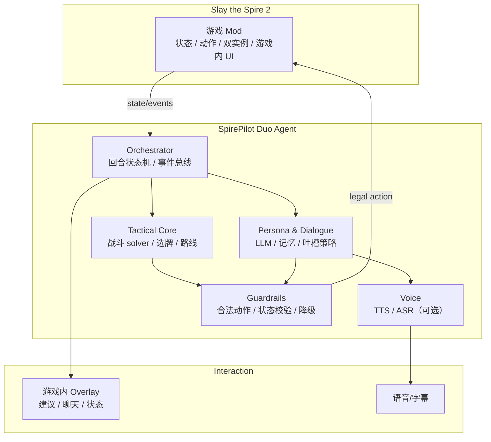

# SpirePilot Duo：StS2 AI 双排规划与难点分析

> 版本：v0.1（方向重写稿）
> 日期：2026-10-22
> 输入：`AI双排视频.mp4`（104 秒，StS2 双角色 co-op + AI 实时评论/操作）
> 关联：[01-开题分析](01-开题分析.md)、[02-项目规划](02-项目规划.md)、[03-战斗建议 MVP](03-战斗建议MVP说明.md)、[07-竞品与方案调研](07-竞品与方案调研.md)、[09-STS2-Agent 功能分析](09-STS2-Agent功能分析.md)、[10-AI双排项目执行规划](10-AI双排项目执行规划.md)、[06-问题记录](06-开发问题与解决方案.md)

---

## 0. 结论摘要

**这是 Agent，而且不是普通聊天 Agent，是“游戏内具身协作 Agent”。**

目标形态：

```text
人类玩家 + AI 队友（自己的角色/自己的回合）
  + 战术求解器（保证不蠢）
  + 人格/语音层（像真人搭子）
  + 游戏内 overlay（看得见、能对话）
```

可行性结论：

| 目标 | 可行性 | 说明 |
|---|---|---|
| AI 看懂手牌/牌组/遗物/敌人并给建议 | 高 | STS2MCP / STS2-Agent 已能提供状态 |
| AI 选牌建议 + 理由 | 高 | 规则/tier + 牌组协同即可做 MVP |
| AI 在游戏内说话、吐槽、语音 | 中高 | LLM + TTS + overlay 成熟 |
| AI 控制第二个角色双排 | 中 | 已有开源项目验证；难在同步、稳定、存档隔离 |
| AI 打得“不蠢”，高进阶接近高手 | 低—中 | 纯 LLM 不行；必须“战术 solver + LLM 分工” |
| 从零做一个完整产品 | 低 | 不建议；已有 STS2-Agent 等基础设施可复用 |

**最重要的建议：不要从零造双实例/游戏内 overlay。先复用现有 mod/协议，把精力放在“中文人格 + 混合决策 + 可解释”上。**

---

## 1. 视频观察：用户到底想要什么

从视频画面可确认：

- StS2 双角色 co-op：静默猎手 + 铁甲战士。
- 顶部有 `Spire Buddy` 状态条。
- AI 以中文语音/字幕实时点评：遗物、事件选项、战斗动作。
- AI 不只是聊天：会讨论“熔岩石/龙涎香”“先挡满再增伤补刀”等具体决策。
- 画面里 AI 有自己的角色/回合，形态接近“AI 队友”，不是单纯弹幕机器人。

把需求翻译成产品语言：

| 编号 | 需求 | 产品含义 |
|---|---|---|
| R1 | AI 知道我有哪些卡 | 实时读取手牌、牌组、遗物、药水、金币、路线 |
| R2 | 新卡选择建议 | 奖励/商店/事件选牌排序 + 理由 + skip |
| R3 | 推荐打什么牌 | 战斗内动作建议，最好能给目标/顺序/预计战损 |
| R4 | 像真人队友 | 人格、语气、吐槽、主动/被动对话、语音 |
| R5 | 不要太蠢 | 战术正确性、合法性、长期策略、不要幻觉 |
| R6 | 双排 | AI 控制自己的角色，和人类协同 |

关键矛盾：

> **R4 的“像人”要求表达自由；R5 的“不蠢”要求决策受约束。**  
> 正确做法不是让一个大模型同时做两件事，而是分层：solver 负责对，persona 负责像。

---

## 2. 这属于 Agent 吗？

属于。按能力分层：

| 层级 | 形态 | 例子 | 是否目标 |
|---|---|---|---|
| L0 | Chatbot | 问它“打击几费” | 否 |
| L1 | 工具型 Agent | 读状态、查卡牌、给建议 | 是（MVP） |
| L2 | 具身游戏 Agent | 在游戏里执行动作、自己的角色 | 是（目标） |
| L3 | 多 Agent 协作 | 人类 + AI 队友 + 战术 solver + 解说 | 是（最终） |

目标系统具备 Agent 的核心闭环：

```text
Perceive（读游戏状态）
  -> Understand（牌组/敌人/资源/局势）
  -> Plan（战术 + 长期策略）
  -> Act（出牌/选牌/移动/对话）
  -> Remember（本局记忆/玩家偏好）
  -> Communicate（语音/字幕/吐槽）
```

但它不是“全自动通关 Agent”，而是**人机混合、可中断、可对话的协作 Agent**。

---

## 3. 现有生态：已经有人做到什么程度

### 3.1 STS2-Agent（最接近视频形态）

- 仓库：https://github.com/CharTyr/STS2-Agent
- **Steam 创意工坊已上线**：https://steamcommunity.com/sharedfiles/filedetails/?id=3796486050
  - 不是独立 Steam 游戏，是 StS2 的 Workshop Mod；
  - **订阅免费**，但需要拥有 StS2；
  - 需要 StS2 `v0.111.0` 或更新版本；
  - 不附带账号/API Key/托管模型，模型 token 费用自付；
  - 支持 DeepSeek、硅基流动、ChatGPT、Ollama / LM Studio 等 OpenAI-compatible 端点；
  - 页面显示 9 月 5 日发布、9 月 24 日更新（抓取于 2026-10-22，订阅数约 473）。
  - macOS 注意：Workshop/发布包主要面向 Windows；Linux/macOS 有源码构建脚本，但双开 co-op 在 macOS 上需要实机验证。
- **已知问题（2026-10-22，macOS）**：游戏语言为简体中文时，overlay 中文全部显示为 `□`（tofu），但 URL/英文可读；判断为 Godot 字体缺少 CJK fallback，不是编码/配置错误。临时绕过：把游戏语言切到 English 并重启。已向作者反馈的价值很高。
- 能力：
  - 游戏内 F8 overlay；
  - OpenAI-compatible LLM 端点；
  - 自动战斗/选牌/商店/事件/路线；
  - **本地双实例 co-op：人类一个角色，AI 一个角色**；
  - 团队聊天、主动短评、人格语气选项；
  - 本地 HTTP API + MCP。
- 许可：AGPL-3.0。
- 结论：**视频里的“AI 双排”在工程上已经被验证可行**；从零再做一个“能双排”的底座意义不大。

### 3.2 STS2MCP（我们当前用的）

- 仓库：https://github.com/Gennadiyev/STS2MCP
- 单机/多人 co-op 状态与动作 API；MCP server；菜单/大厅控制。
- 优点：轻、协议清楚、我们已接好。
- 缺点：没有游戏内 overlay/语音/人格；co-op 仍是 beta。
- 定位：适合做**观战参谋/研究数据源**，不适合单独做“AI 队友产品”。

### 3.3 AI 队友 MOD（规则型）

- 游侠页面：https://patch.ali213.net/showpatch/305213.html
- 本地伪多人，1–3 名 AI 队友，按角色 JSON 配置行为；战斗/奖励/药水/商店/事件。
- 特点：稳定、便宜、可离线；但“人格/语音/解释”弱，策略上限有限。
- 启示：**不是所有决策都需要 LLM**；规则型队友已经能跑通 co-op。

### 3.4 CombatSolver（战斗强度上限）

- 仓库：https://github.com/Torch1230/CombatSolver
- 跨回合 beam、预算搜索、overlay、自动执行；MIT。
- 启示：战斗“不蠢”要靠搜索/模拟，不是靠 prompt。

### 3.5 BoberInSpire / sts2-card-advisor（UI 参考）

- BoberInSpire：C# mod + Python + Tauri 置顶窗口。
- sts2-card-advisor：游戏内卡牌奖励 overlay。
- 启示：**overlay 是刚需**；选牌建议要贴着卡牌显示。

---

## 4. 产品定义：SpirePilot Duo

### 4.1 一句话

> 一个懂 StS2、能看牌、能选牌、能指挥战斗、能陪你说话/吐槽的中文 AI 双排搭子；战术上由 solver 保底，表达上由 persona 放飞。

### 4.2 三种模式（按风险从低到高）

| 模式 | AI 做什么 | 人类做什么 | 风险 | 建议 |
|---|---|---|---|---|
| **A. 观战搭子** | 看状态、点评、选牌/战斗建议 | 全部操作 | 低 | **MVP 先做** |
| **B. 双排参谋** | 实时建议 + 语音对话；不碰操作 | 人类操作两个角色 | 低—中 | 第二版 |
| **C. 双排队友** | 控制自己的角色；和人类协同 | 控制自己的角色 | 中—高 | 目标形态 |

不要一上来做 C。A 能验证“懂不懂、像不像、说不说人话”；B 验证协作；C 才验证双实例/执行/同步。

### 4.3 非目标

- 不做“全自动通关”作为卖点；
- 不做排行榜/成就竞速；
- 不做无授权的语音克隆；
- 不承诺高进阶百分百正确；
- 不把 LLM 当规则引擎。

---

## 5. 系统架构



### 5.1 关键设计：双脑

```text
战术脑（deterministic / search）
  - 战斗：solver，给合法动作、预计战损、击杀线
  - 选牌：规则/评分/牌组协同
  - 路线：风险/收益/精英/商店

表达脑（LLM）
  - 把战术结果翻译成人话
  - 吐槽、鼓励、复盘
  - 理解玩家自然语言指令
  - 不做数值计算，不直接决定动作
```

原则：

> **LLM 负责“说什么”，solver 负责“做什么”。**  
> 任何 LLM 输出在送到游戏前，必须经过合法动作校验。

### 5.2 决策路由

| 场景 | 决策者 | LLM 角色 |
|---|---|---|
| 战斗出牌 | solver | 解释/点评 |
| 卡牌奖励 | 评分器 | 解释协同/风格 |
| 地图路线 | 规则/风险模型 | 讨论偏好 |
| 事件选项 | 规则 + LLM 理解文本 | 解读/建议 |
| 商店 | 经济模型 | 吐槽/取舍 |
| 聊天 | LLM | 主角色 |
| 双排协同 | 协议 + LLM | 自然语言沟通 |

### 5.3 延迟预算

| 环节 | 目标 |
|---|---|
| 读状态 + 本地建议 | < 300 ms |
| solver 单回合 | 0.1–2 s（可后台预计算） |
| LLM 短评 | 0.8–2 s |
| TTS 首包 | < 1.5 s |
| 玩家语音指令识别 | < 1 s（可选） |

敌人回合/动画期间是**预计算窗口**；不要等玩家出牌才开始想。

---

## 6. “不蠢”怎么做

### 6.1 纯 LLM 为什么不行

- 算术/概率不可靠；
- 长战斗容易忘状态；
- 会幻觉不存在的卡/遗物；
- 高进阶需要精确伤害/格挡/抽牌；
- token 成本高，延迟大。

### 6.2 混合策略

1. **战斗**：沿用/增强 SpirePilot 的 exact/beam/rollout；输出合法动作、预计掉血、击杀线。
2. **选牌**：规则评分 + 牌组协同 + tier 先验；LLM 只解释。
3. **路线**：风险模型 + 玩家偏好；LLM 讨论。
4. **协同**：约定目标/药水/遗物分配；LLM 负责对话，协议负责执行。
5. **置信度**：solver 分差小/局面危险时，AI 主动说“我倾向 X，但你可以 Y”，而不是硬装专家。

### 6.3 卡牌知识

当前 SpirePilot 只有 Ironclad 87 张数据，规则层 15 张特殊处理；这不够做“所有角色队友”。

必须先做：

- 全角色卡牌/遗物/药水/敌人元数据；
- 效果 DSL 或按卡牌 ID 的处理器；
- 覆盖审计：完全支持/部分支持/未支持；
- 未知卡牌降级为“文本理解 + 保守建议”，并明确告诉玩家。

> 对“AI 队友”来说，**知道自己不知道**比假装知道更重要。

### 6.4 评估

| 指标 | 说明 |
|---|---|
| 非法动作率 | 必须为 0 |
| 与 solver/专家一致率 | 战术正确性 |
| 平均战损/胜率 | 固定种子/固定战斗集 |
| 响应延迟 | 建议/语音 |
| token/局 | 成本 |
| 人格评分 | 有趣/不烦/像队友（5 分） |
| 信任/理解 | 玩家是否听懂理由 |
| 崩溃/软锁/存档损坏 | 必须为 0 |

---

## 7. “像真人队友”怎么做

### 7.1 人格卡

不要只写“你是一个幽默的队友”。要定义：

```yaml
name: 鱼妹妹
role: 双排搭档
tone: 嘴硬心软，偶尔阴阳，但不人身攻击
initiative: 中等（关键节点主动说，不刷屏）
catchphrases:
  - “这波不亏。”
  - “你先别急，我挡。”
boundaries:
  - 不剧透未发现内容
  - 不攻击玩家现实身份
  - 不伪造数字
```

### 7.2 什么时候说话

- 战斗开始/结束；
- 抽到关键牌/遗物；
- 玩家明显失误（可选，注意语气）；
- 危险回合/击杀线；
- 选牌/商店/事件；
- 玩家主动问；
- 长时间沉默后的一句短评。

**不要每出一张牌都说。** 语音队友最怕刷屏。

### 7.3 吐槽的边界

- 吐槽决策，不吐槽人；
- 先给信息，再给情绪；
- 可配置“嘴臭等级”；
- 支持静音/仅字幕；
- 不攻击外貌/身份/家庭；
- 明确 AI 身份，不假装真人。

### 7.4 语音

- TTS：豆包语音/火山引擎、Fish Audio、GPT-SoVITS 等；
- 先做“字幕 + 可选语音”，不要一开始做全双工语音；
- 语音指令（ASR）是加分项，不是 MVP；
- 延迟比音色更重要。

---

## 8. 双排协同的难点

| 难点 | 说明 | 缓解 |
|---|---|---|
| 双实例 | 两个游戏进程、端口、配置、存档隔离 | 复用 STS2-Agent 的 launcher/isolation；不要自己造 |
| 回合同步 | 人类/AI 谁先动、是否等待 | 事件驱动 + 状态机；超时/跳过 |
| 共享资源 | 金币/药水/遗物/路线选择 | 明确协议；AI 先询问 |
| 目标选择 | 集火/分工/挡伤 | solver 给目标；LLM 用自然语言确认 |
| 状态漂移 | 预测与实际不一致 | 每回合校验状态 hash；偏差即重算 |
| 存档安全 | 双实例覆盖/云存档冲突 | 独立 profile/配置；只读备份；不自动清存档 |
| 版本漂移 | 游戏更新导致 mod API 失效 | 锁版本；启动自检；降级到观战模式 |
| 平台 | macOS/Windows 路径/进程差异 | 先支持当前 macOS，再 Windows |

---

## 9. 里程碑规划

### Phase 0：验证与选型（1 周）

- 安装/试玩 STS2-Agent（或同类），验证 macOS 双实例 co-op。
- 确认：能否用 OpenAI-compatible 端点接豆包/DeepSeek。
- 确认：语音 TTS 方案与延迟。
- 产出：build vs integrate 决策；风险清单。

### Phase 1：观战搭子 MVP（2–3 周）

- 读状态：手牌/牌组/遗物/敌人/奖励。
- 战斗建议：复用 SpirePilot exact/beam。
- 选牌建议：规则 + 牌组协同 + 理由。
- Overlay：游戏上方/置顶；字幕；可选 TTS。
- 不控制角色。
- 验收：连续 10 场不崩溃；建议合法；延迟 < 1s；玩家能看懂理由。

### Phase 2：双排参谋（2 周）

- 团队聊天：玩家自然语言问“打左边还是右边”。
- AI 结合状态回答；不执行。
- 关键节点主动短评。
- 验收：玩家觉得“像队友”，不是“查攻略”。

### Phase 3：AI 队友（3–4 周）

- 双实例/第二角色；AI 执行自己的回合。
- 战斗 solver 保底；LLM 负责交流。
- 选牌/商店/事件/路线按模式接管。
- 故障恢复/暂停/接管。
- 验收：10 场 co-op 无存档损坏/软锁；非法动作 0；可随时暂停。

### Phase 4：人格与评估（2 周）

- 人格卡、吐槽等级、记忆（本局/长期偏好）。
- TTS 音色/语速/打断。
- A/B：有 AI vs 无 AI；有趣/有用/烦人。
- 产出：演示视频、评估报告、Workshop/发布说明。

> 总周期：**8–10 周**（1 人、已有基础设施）。从零做底座则 3–6 个月。

---

## 10. 难点矩阵

| 维度 | 难度 | 主要风险 | 应对 |
|---|---:|---|---|
| 游戏接入/双实例 | ★★★★★ | 存档、端口、版本、平台 | 复用成熟 mod；隔离；只读备份 |
| 状态/动作覆盖 | ★★★★ | 事件/弹窗/联机同步 | 状态机；合法动作校验；降级 |
| 战术质量 | ★★★★★ | 高进阶、长战斗、隐藏抽牌 | solver + rollout；预算；置信度 |
| 卡牌知识 | ★★★★ | 全角色/遗物/药水 | 数据管道 + 覆盖审计 + DSL |
| LLM 可靠性 | ★★★★ | 幻觉、延迟、成本 | 受约束输出；模板；缓存；小模型 |
| 语音 | ★★★ | 延迟、音色、打断 | 字幕优先；TTS 流式；可静音 |
| 人格/娱乐 | ★★★ | 重复、烦、冒犯 | 人格卡；频率控制；边界 |
| 双人协同 | ★★★★ | 抢资源/目标/节奏 | 协议；询问；可暂停 |
| 评估 | ★★★★★ | 没有 ground truth | 固定种子/战斗集；人评；A/B |
| 合规/分发 | ★★★ | AGPL、EULA、配音版权 | 许可证审计；不抄袭资源；披露 AI |

### “好实现吗”的直接回答

- **做一个能看牌、会点评、会给建议的观战搭子**：**好实现**，2–3 周。
- **做一个能双排、能说话、偶尔吐槽的 AI 队友**：**中等**，已有开源底座，2–3 个月可到可玩。
- **做一个高进阶“不蠢”的 AI 队友**：**难**，需要强 solver/大量评估，可能 6 个月以上；不要承诺“比人强”。
- **从零做双实例 + overlay + 语音 + solver**：**不建议**，重复造轮子。

---

## 11. 构建 vs 复用

| 方案 | 工作量 | 风险 | 建议 |
|---|---|---|---|
| 从零写 C# mod + 双实例 + overlay | 很大 | 高 | 不推荐 |
| Fork/扩展现有 STS2-Agent | 中 | 中（AGPL/版本） | **推荐做 C 模式** |
| STS2MCP + 我们自己的 Python agent + 外部 overlay | 小—中 | 低（无游戏内执行） | **推荐做 A/B 模式** |
| 规则型 AI 队友 + 我们的解说层 | 小 | 低 | 快速 demo |

许可提醒：

- STS2-Agent 是 **AGPL-3.0**；分发修改版要遵守 AGPL。
- CombatSolver 是 MIT；Random Foreseer 是 MIT。
- 游戏资源/卡牌文本归 Mega Crit；不要重新分发美术/音频。
- 语音克隆需要本人授权。

---

## 12. MVP 验收标准

必须全部满足：

- [ ] 读取当前手牌/牌组/遗物/敌人/奖励，字段正确率 ≥ 99%。
- [ ] 战斗建议合法动作率 100%；给出目标与预计掉血。
- [ ] 卡牌奖励给出 top-1/top-3 + 理由 + skip。
- [ ] 中文对话/吐槽可开关；不刷屏；可静音。
- [ ] 延迟：建议 < 1s；语音首包 < 2s。
- [ ] 连续 10 场不崩溃、不软锁、不损坏存档。
- [ ] 玩家盲测：≥ 60% 认为“有用”，≥ 50% 认为“像队友”。
- [ ] 明确 AI 身份；不伪造数字；不攻击玩家。

---

## 13. 建议的下一步

1. **先试 STS2-Agent**：用当前 macOS 环境验证双实例 co-op、F8 overlay、OpenAI-compatible 端点。
2. **确定 MVP 模式**：A（观战搭子）优先，B 次之，C 作为目标。
3. **接入中文人格/TTS**：先字幕，后语音。
4. **把 SpirePilot 的 solver 接进去**：战斗/选牌用确定性核心，LLM 只解释。
5. **做 5 场人工试用**：记录“有用/像队友/太烦/太蠢”的具体案例，再迭代。

> 不要把“AI 双排”做成“LLM 即兴表演”。  
> 它的核心是：**游戏状态可靠 + 战术决策可信 + 人格表达有趣**。三者缺一不可。

---

## 14. 参考

- STS2-Agent: https://github.com/CharTyr/STS2-Agent
- STS2MCP: https://github.com/Gennadiyev/STS2MCP
- CombatSolver: https://github.com/Torch1230/CombatSolver
- BoberInSpire: https://github.com/S0ul3r/BoberInSpire
- sts2-card-advisor: https://github.com/ing-gom/sts2-card-advisor
- AI 队友 MOD（游侠）: https://patch.ali213.net/showpatch/305213.html

---

## 18. 工期估算（基于现有 STS2-Agent 底座）

> 前提：不重写双实例/overlay 底座；用 STS2-Agent 做游戏接入，用 SpirePilot 做战术脑；你能提供 API Key 并每周实机测试 1–2 次。时间是“有效开发时间”，不是自然日承诺。

| 目标 | 估算 | 说明 |
|---|---:|---|
| 观战搭子：看牌、选牌建议、战斗建议、简单吐槽 | **1–2 周** | 不控制角色；外部 Python 服务 + overlay/终端；风险最低 |
| AI 双排：AI 控制第二个角色，和人类同局 | **3–5 周** | 用 STS2-Agent 的 external takeover/API；难点是同步、事件/奖励/路线、异常恢复 |
| 中文语音 + 人格 + 记忆 + 稳定 | **2–3 个月** | TTS/ASR、语气、打断、延迟、存档/版本回归 |
| 高进阶“不蠢”，接近高手 | **6 个月+，不保证** | 需要强 solver + 全卡牌覆盖 + 大量评估；纯 LLM 做不到 |

### 最快路径

1. **第 1 周**：STS2-Agent 外部接管跑通；Python 读 `/state`、发 `/action`；做“观战搭子” demo。
2. **第 2–3 周**：接入 SpirePilot exact/beam，做选牌评分、战斗理由、简单人格台词。
3. **第 3–5 周**：让 AI 接管第二个角色；处理奖励/商店/事件/路线/暂停/重连。
4. **第 6–10 周**：TTS、人格、记忆、评估、打包；macOS 字体/双开问题单列风险。

### 最大不确定性

- macOS 双开/字体/Steam Workshop 兼容性；
- LLM tool calling 与延迟；
- SpirePilot 当前只有 Ironclad 子集（87 张数据、15 张特殊处理），不足以支撑“全角色不蠢”；
- 真实对局测试只能靠你/实机，不能只靠离线单测。
