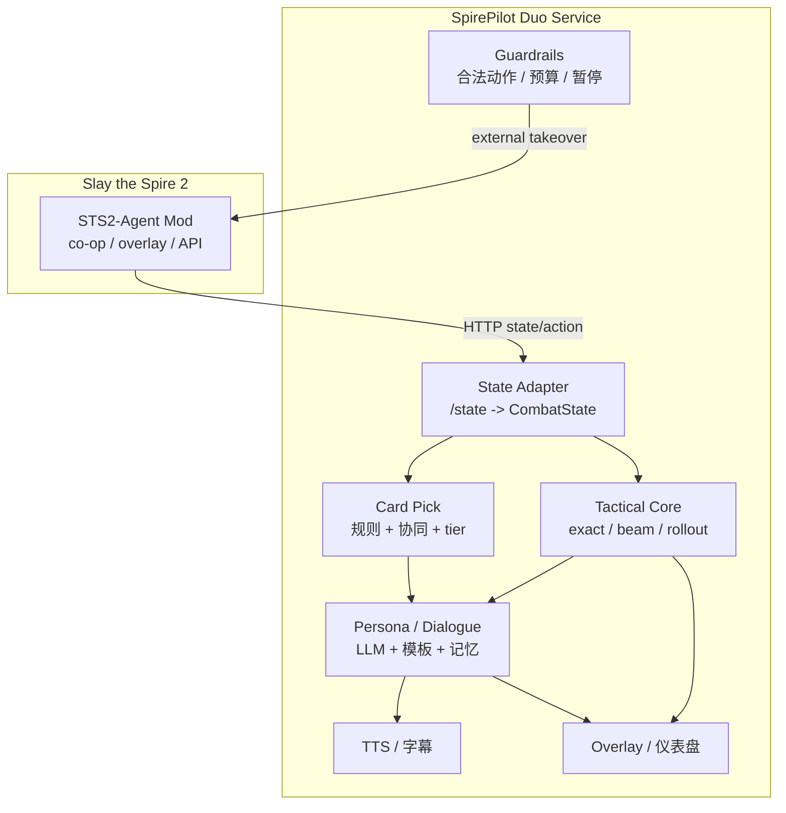

# SpirePilot Duo：AI 双排项目执行规划

> 版本：v0.1（执行版）
> 日期：2026-10-22
> 定位：基于现有 `STS2-Agent` 的游戏接入/双实例能力，做一个**中文 AI 双排搭子**；不自研双实例底座。
> 关联：[AI 双排规划与难点分析](08-AI双排规划与难点分析.md)、[STS2-Agent 功能分析](09-STS2-Agent功能分析.md)、[战斗建议 MVP](03-战斗建议MVP说明.md)、[开题报告 PPT 文案](11-开题报告-AI双排助手.md)

---

## 1. 项目目标

### 1.1 一句话

> 一个懂 StS2、能看牌、能选牌、能指挥战斗、能陪聊/吐槽的中文 AI 双排搭子；战术上由 solver 保底，表达上由 persona 放飞。

### 1.2 三个必须

1. **看得懂**：知道手牌、牌组、遗物、药水、敌人、路线、奖励。
2. **不犯蠢**：动作合法；战斗/选牌有确定性依据；不幻觉不存在的卡。
3. **像队友**：能主动说关键话、能接话、能吐槽，但不刷屏、不冒犯。

### 1.3 非目标（本期）

- 不做“全自动通关”作为卖点；
- 不做排行榜/成就竞速；
- 不做无授权的声音克隆；
- 不承诺高进阶“比人强”；
- 不从零重写双实例/游戏内 overlay。

---

## 2. 产品形态与范围

### 2.1 三种模式

| 模式 | AI 做什么 | 人类做什么 | 风险 | 计划 |
|---|---|---|---|---|
| **A. 观战搭子** | 看状态、选牌建议、战斗建议、点评/吐槽 | 全部操作 | 低 | **MVP 先做** |
| **B. 双排参谋** | 实时建议 + 语音对话；不操作 | 人类操作两个角色 | 低—中 | 第二版 |
| **C. AI 队友** | 控制自己的角色；和人类协同 | 控制自己的角色 | 中—高 | 目标形态 |

**本期交付顺序：A → B → C。**  
没有通过 A 的“懂不懂/像不像”验收，不进入 C。

### 2.2 MoSCoW

| 优先级 | 内容 |
|---|---|
| **Must** | 状态读取、手牌/牌组/遗物显示、战斗建议、卡牌奖励 top-1/理由、简单吐槽、可暂停/静音 |
| **Should** | exact/beam 对比、预计掉血、击杀线、选牌 skip、主动短评、TTS、本局记忆 |
| **Could** | AI 控制第二角色、地图投票、团队语音、长期偏好、A/B 人格 |
| **Won't（本期）** | 全角色全卡池、全自动通关、排行榜、云端账号系统 |

---

## 3. 技术路线

### 3.1 不自研底座

复用 `STS2-Agent`：

- 双实例 co-op
- 游戏内 overlay
- `/state`、`/actions/available`、`/action`
- `/teammate/control`、队友 API
- 预算/熔断/存档隔离

我们新增：

```text
SpirePilot Duo Service（Python）
  - STS2-Agent 状态 adapter
  - 战术 solver（exact / beam / rollout）
  - 选牌评分器
  - 人格/台词/记忆
  - TTS
  - 外部 overlay/仪表盘
```

### 3.2 架构



### 3.3 双脑原则

```text
战术脑（solver / 规则）
  - 出哪张牌、打谁、是否结束回合
  - 选牌评分
  - 预计掉血/击杀线

表达脑（LLM）
  - 把结果说成人话
  - 吐槽/鼓励/复盘
  - 理解玩家自然语言
  - 不做数值计算，不直接决定动作
```

**LLM 负责“说什么”，solver 负责“做什么”。**

### 3.4 两种接入方式

| 方式 | 用途 | 是否改 STS2-Agent |
|---|---|---|
| 只读 | A 观战搭子、选牌/战斗建议 | 不改 |
| 外部接管 | C AI 队友（驱动队友角色） | 不改；通过队友 API |

外部接管入口：

- 主窗口 `POST /teammate/control`
- 队友实例 `GET /state`、`POST /action`
- 队友端口从主窗口 `/health` 的 `companion.api_port` 获取

### 3.5 为什么“同一套理论”不等于“同一套系统”

这个判断只说对了一半：

**能复用：**

- 读牌/读状态
- 合法动作枚举
- 出牌/选牌评分
- LLM prompt/人格
- 动作执行前的校验
- CombatSolver/Jev 这类战术后端

**不能直接复用：**

| 问题 | 单机 Spire Buddy | 双人 co-op |
|---|---|---|
| 角色 | 只有一个本地玩家 | 两个玩家实体，动作必须带 actor |
| 状态 | 一份手牌/能量 | 两份手牌/能量/遗物，共享敌人 |
| 回合 | 自己说了算 | 要等对方、同步、处理同时/先后手 |
| 奖励/地图 | 自己选 | 地图投票、共享流程、队友等待 |
| 进程 | 一个游戏进程 | 双进程、端口、token、配置隔离 |
| 存档 | 单机 profile | 联机 NetId、读档路径、坏档风险 |
| UI | 一个面板 | 主窗口/队友窗口/状态同步 |
| 安全 | 不会替别人出牌 | 必须禁止 `forbidden_actor` |

Spire Buddy 自己的 README 也写了：**multiplayer 会禁用它的本地斩杀校验**。这正说明它不是为双人 actor 模型设计的。

结论：

> **“AI 会打牌”可以复用；“AI 作为一个合法第二玩家”需要新的一层 co-op 适配。**  
> 最省力的路线不是把 Spire Buddy 复制两份，而是保留它的“脑子”，接 STS2-Agent 的“双人身体”。

### 3.6 平台策略

- 先以 **当前 macOS** 为主开发环境；
- 如果 macOS 双开不可用，降级为 A（观战搭子）；
- Windows 作为 C 模式的备选验证环境；
- 所有平台都先做只读 A，再做控制 C。

---

## 4. 功能规划

### 4.1 状态与展示

- 手牌（名称/费用/可打出/目标）
- 牌组、抽弃牌堆
- 遗物、药水
- 敌人 HP/格挡/意图
- 金币/楼层/Act/Ascension
- 当前屏幕（战斗/奖励/商店/事件/地图）

### 4.2 战斗建议

- 当前回合 exact 搜索（模型内最优）
- beam 对比
- 2 回合 rollout 诊断
- 输出：
  - 推荐动作 + 手牌索引 + 目标
  - 预计掉血 / 敌方剩余 HP / 是否击杀
  - 备选 top-3
  - 理由（引用具体数值）

### 4.3 卡牌奖励建议

- 三选一排序 + skip
- 依据：
  - 卡牌强度/tier
  - 牌组协同/角色定位
  - 当前 Act/Boss/血量
  - 稀有度/费用曲线
- 输出 top-1 + 2–3 条理由
- LLM 只解释，不直接打分

### 4.4 对话与人格

- 人格卡：名字、语气、口头禅、吐槽等级、边界
- 触发时机：
  - 战斗开始/结束
  - 关键抽牌/遗物
  - 危险回合/击杀线
  - 选牌/商店/事件
  - 玩家主动问
- 不刷屏；可静音；可仅字幕
- 默认 AI 身份披露，不假装真人

### 4.5 TTS/语音（Should）

- 先字幕，后语音
- 豆包/其他 TTS 适配器
- 流式首包 < 1.5–2 s
- 可打断/静音/语速
- 不做无授权声音克隆

### 4.6 AI 队友（Could，Phase C）

- 控制第二个角色
- 只操作自己的角色
- 与人类地图投票/目标协同
- 暂停/接管/异常恢复
- 不替人类出牌
- 不触碰人类存档

---

## 5. 里程碑与工期

> 时间是“有效开发时间”，前提是：
> - 复用 STS2-Agent，不重写底座；
> - 你能提供模型 API Key；
> - 每周至少 1–2 次实机测试/反馈；
> - 以 Ironclad/基础卡池为 MVP 范围。

### Phase 0：环境验证（2–3 天）

**目标**：确认这条路能走通。

- [ ] STS2-Agent 下载/加载成功
- [ ] `/health`、`/state` 可读
- [ ] 模型 API 连通
- [ ] 工具调用通过（或确认换模型）
- [ ] macOS 双开是否可用
- [ ] 中文字体问题记录/绕过
- [ ] TTS 方案选型

**Gate 0**：如果 `/state` 和模型工具调用都过不了，停止开发，先解决环境。

### Phase 1：观战搭子 MVP（1–2 周）

**目标**：不控制角色，先证明“懂游戏、像队友”。

- [ ] Python 状态 adapter
- [ ] 战斗建议（exact + beam 对比）
- [ ] 选牌建议（top-1 + 理由 + skip）
- [ ] 外部 overlay/仪表盘
- [ ] 简单人格台词（模板 + LLM）
- [ ] 日志/回放/错误提示

**验收**：

- 连续 10 场不崩溃；
- 建议动作 100% 合法；
- 选牌理由能引用具体牌/数值；
- 延迟 < 1–2 s；
- 你主观认为“有用”≥ 7/10。

### Phase 2：双排参谋（1 周）

**目标**：能对话、能主动短评，但不操作。

- [ ] 自然语言问答（“打左边还是右边”）
- [ ] 关键节点主动发言
- [ ] 语气/频率设置
- [ ] 本局记忆（最近决策/失误）
- [ ] 与 overlay 状态同步

**验收**：

- 玩家觉得“像队友”，不是“查攻略”；
- 不刷屏；
- 说错能纠正，不硬编。

### Phase 3：AI 队友（3–5 周）

**目标**：AI 控制第二个角色。

- [ ] 外部接管队友 API
- [ ] 战斗动作执行
- [ ] 奖励/商店/事件/路线
- [ ] 与人类地图投票/目标协同
- [ ] 暂停/继续/接管
- [ ] 异常恢复（状态漂移/非法动作/超时）
- [ ] 存档隔离/备份

**验收**：

- 10 场 co-op 无存档损坏/软锁；
- 非法动作率 0；
- 可随时暂停；
- 人类角色不被 AI 操作。

### Phase 4：人格、语音与稳定化（2–4 周）

- [ ] TTS 接入
- [ ] 人格卡/语气/吐槽等级
- [ ] 记忆/复盘
- [ ] A/B 评估
- [ ] 文档/演示/打包
- [ ] macOS/Windows 回归

### 总工期

| 范围 | 有效时间 |
|---|---:|
| A 观战搭子 | 1–2 周 |
| A + B | 2–3 周 |
| A + B + C | 5–8 周 |
| 稳定/语音/评估 | 8–12 周 |

> 不含“高进阶不蠢”的研究周期；那需要 3–6 个月以上，且不保证。

---

## 6. 周计划（建议）

| 周 | 目标 | 交付 |
|---|---|---|
| W1 | Phase 0 + A 骨架 | 状态读取、overlay 原型、模型连通 |
| W2 | A 战斗建议 | exact/beam、预计掉血、理由 |
| W3 | A 选牌 + 人格 | top-1、skip、简单吐槽 |
| W4 | B 对话 | 问答、主动短评、记忆 |
| W5–W6 | C 战斗接管 | 队友 API、出牌/结束回合 |
| W7 | C 全流程 | 奖励/商店/事件/路线 |
| W8 | 稳定化 | 暂停/恢复/存档/日志 |
| W9–W10 | 语音/人格 | TTS、语气、A/B |
| W11–W12 | 打包/评估 | 演示、文档、回归 |

---

## 7. 人员与分工

| 角色 | 谁 | 职责 |
|---|---|---|
| 产品/目标 | 你 | 定优先级、试玩、判断“像不像/蠢不蠢” |
| 开发/集成 | 我 | 代码、adapter、solver、人格、测试、文档 |
| 实机测试 | 你 + 我指导 | 跑游戏、抓状态、反馈异常 |
| 模型/语音账号 | 你 | API Key、TTS 账号/音色授权 |

### 我需要你提供的

1. 模型 API（DeepSeek/豆包/OpenAI-compatible）与 Key；
2. 每周 1–2 次实机测试时间；
3. 人格偏好（名字/语气/吐槽等级）；
4. 是否接受先用英文模型、后做中文语音；
5. macOS 双开是否必须，还是可以先做观战搭子。

---

## 8. 评估指标

### 8.1 战术

| 指标 | 目标 |
|---|---|
| 非法动作率 | 0 |
| 推荐合法性 | 100% |
| 与 exact/专家一致率 | 记录，不强行定 100% |
| 平均掉血 | 与 baseline 对比 |
| 击杀线识别 | 抽检准确 |
| 延迟 | 建议 < 1–2 s |

### 8.2 体验

| 指标 | 目标 |
|---|---|
| 有用 | ≥ 7/10 |
| 像队友 | ≥ 6/10 |
| 烦人 | ≤ 3/10 |
| 信任 | ≥ 6/10 |
| 崩溃/软锁 | 0 |

### 8.3 成本

- 每局 token；
- 每局 TTS 字符/费用；
- 平均响应延迟；
- 预算上限触发次数。

---

## 9. 风险登记

| 风险 | 概率 | 影响 | 缓解 |
|---|---|---|---|
| macOS 双开不可用 | 中 | 高 | 先做 A；C 转 Windows/延后 |
| 中文字体 tofu | 高 | 中 | 外部 overlay 自带 CJK 字体；或英文 UI |
| 模型不支持 tools | 高 | 高 | 换模型；Play/Chat 分离 |
| LLM 延迟高 | 高 | 中 | solver 本地决策；预计算；小模型 |
| 卡牌覆盖不足 | 高 | 高 | 先 Ironclad 基础池；覆盖审计；明确边界 |
| 存档损坏 | 低 | 极高 | 隔离 profile；备份；不自动读档 |
| 游戏更新破坏反射/API | 中 | 高 | 锁版本；启动自检；降级 A |
| AGPL/语音版权 | 中 | 中 | 不复制代码/资源；声音授权；披露 AI |
| 人格冒犯/刷屏 | 中 | 中 | 语气等级；频率限制；静音 |

---

## 10. 交付物

| 编号 | 交付物 | 验收 |
|---|---|---|
| D1 | `duo` Python 服务 | 读状态、给建议、可运行 |
| D2 | 外部 overlay | 手牌/建议/对比/延迟 |
| D3 | 战斗建议报告 | exact/beam/rollout 对比 |
| D4 | 选牌评分器 | top-1/skip + 理由 |
| D5 | 人格/台词包 | 可配置语气/频率 |
| D6 | TTS 适配器 | 可静音/打断 |
| D7 | 队友接管 | 可控制第二角色 |
| D8 | 评估报告 | 10 场数据 + 失败案例 |
| D9 | 文档/演示 | README、视频、风险清单 |

---

## 11. 决策门

### Gate 1：A 是否值得继续

- 建议是否合法/有用？
- 玩家是否觉得像队友？
- 延迟是否可接受？

不通过：只保留“战斗/选牌顾问”，不做 C。

### Gate 2：C 是否可做

- macOS 双开是否稳定？
- 队友 API 是否可控？
- 存档是否安全？

不通过：C 延后，先做 B。

### Gate 3：是否值得做语音

- 字幕版是否已经有用？
- TTS 延迟/成本是否可接受？
- 玩家是否真的需要语音？

不通过：只做字幕。

---

## 12. 第一周具体任务

### Day 1–2

- [ ] 确认 STS2-Agent 版本/加载
- [ ] `/health`、`/state`、`/actions/available` 抓取
- [ ] 模型 tool calling 测试
- [ ] macOS 双开探测
- [ ] 记录字体/平台问题

### Day 3–4

- [ ] 写 `sts2_agent_adapter.py`
- [ ] 把 `/state` 映射到 SpirePilot `CombatState`
- [ ] 复用 exact/beam
- [ ] 终端输出建议

### Day 5–7

- [ ] Tkinter/本地 Web overlay
- [ ] 手牌/建议/预计掉血
- [ ] 简单人格台词
- [ ] 10 场战斗冒烟

---

## 13. 立即可做的下一步

1. 确认你接受“先 A 后 C”的顺序；
2. 提供可用模型/Key（或先本地 Ollama）；
3. 确认人格：名字、语气、吐槽等级；
4. 确认 macOS 双开是否必须；
5. 我开始 Phase 0/1，先把“观战搭子”跑通。

> 原则：**每周都要有可试玩的增量；不做“憋三个月再给你看”的大工程。**
