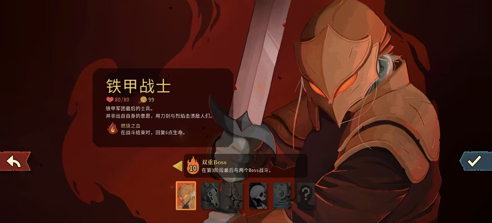
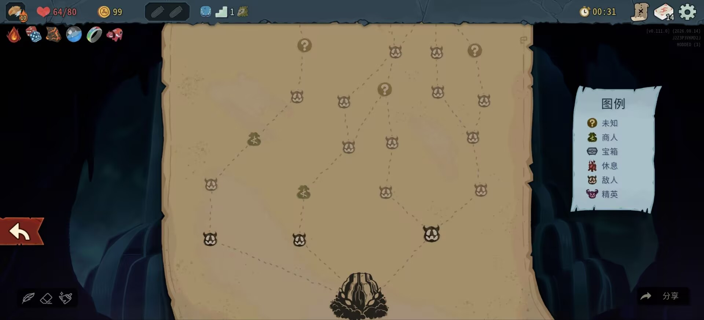
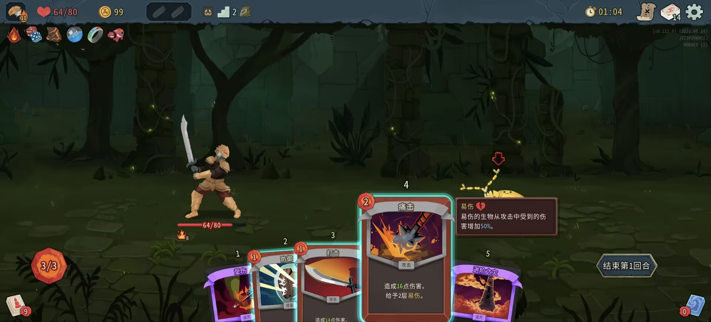
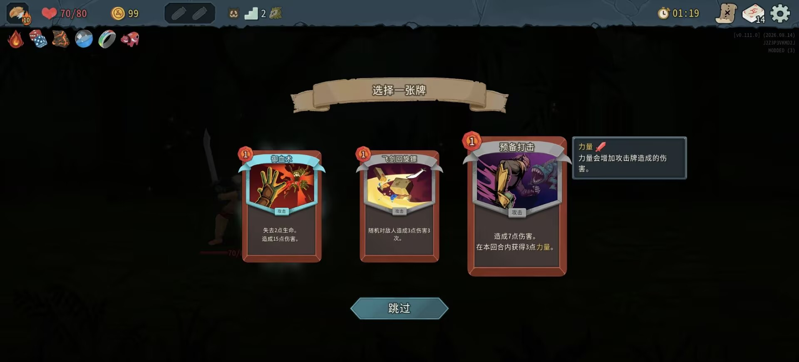
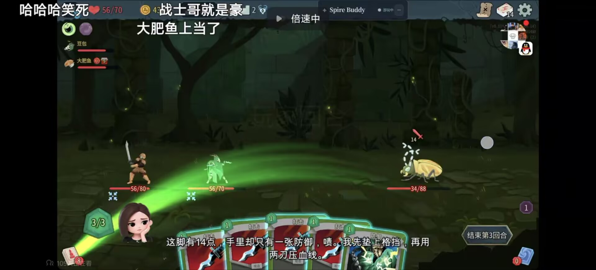
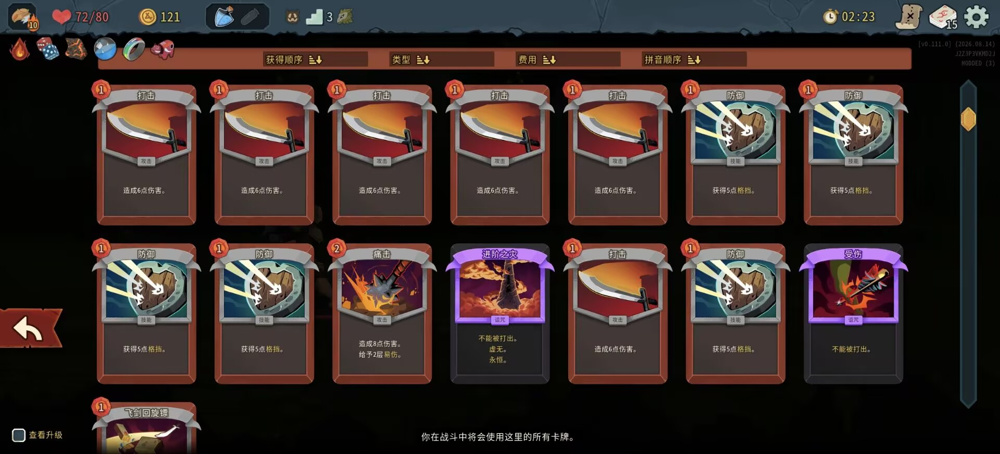
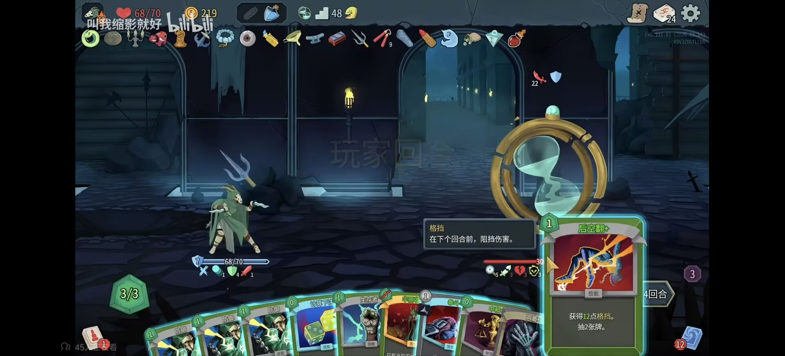
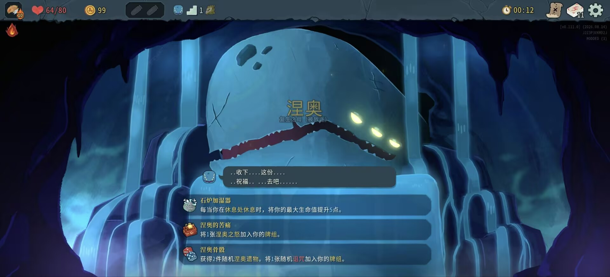
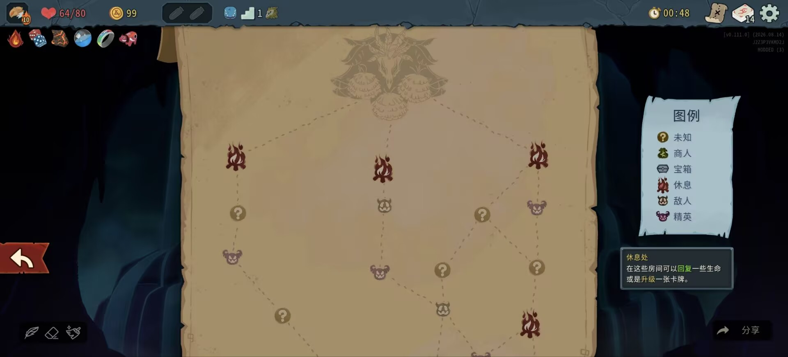
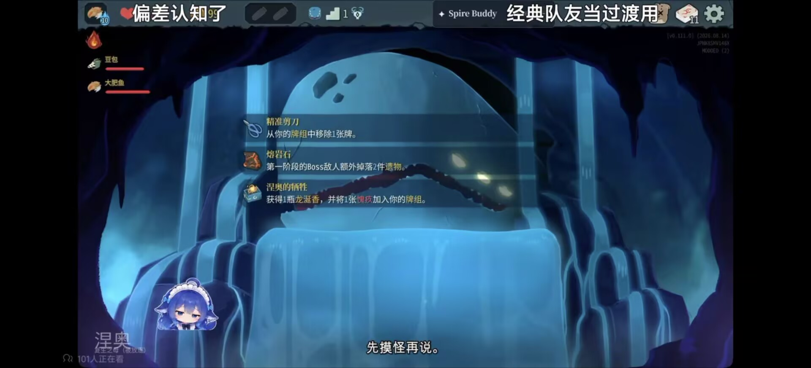

# 《杀戮尖塔 2》AI 双排助手｜开题答辩 PPT 大纲

## 制作约束

- 总页数：16 页，含封面与结束页。
- 内容来源：仅提炼开题报告中的必要信息，不把讲稿、附录问答和参考链接堆入页面。
- 视觉方向：奶油黄、浅橙、米白为主色，圆润软萌的 Q 版小龙元素与手绘装饰；保持答辩所需的清晰层级和专业感，不照搬现有商业角色形象。
- 游戏截图：10 张均为严格输入素材，保留画面与界面信息，不重绘、不改写截图内数据和文字。
- 页面比例：16:9。

---

## Slide 1｜封面

**标题**：《杀戮尖塔 2》AI 双排助手

**副标题**：开题报告

**关键信息**：

- 汇报人：谭志宝、向洪波、马萌阳、付嘉毅、胡真健
- 日期：2026-10-26
- 一句话定位：能看牌、能算牌、能陪聊、能作为第二名玩家协作

**版式角色与意图**：极简封面。奶油黄留白与柔和橙色标题，右下角设置原创圆润小龙陪伴者剪影。

**Required images**：

- 铁甲战士角色选择画面；严格输入素材；作为右侧大幅主视觉，允许等比裁切边缘，不改变画面内容。

  

---

## Slide 2｜游戏介绍与核心循环

**标题**：游戏介绍与核心循环

**关键点**：

- 《杀戮尖塔 2》是一款卡牌构筑 + Roguelike 策略游戏。
- 基本流程：选择角色、规划路线、回合战斗、获取奖励、构筑牌组、挑战 Boss。
- 每回合消耗有限能量，打出攻击、防御和能力牌。
- 路线、敌人和奖励带有随机性，每局体验不同。
- co-op 中两名玩家分别控制角色，需要共同规划与协作。

**版式角色与意图**：面向不了解游戏的听众，用角色、地图、战斗和卡牌奖励四个真实画面解释完整游戏循环。

**Required images**：

- 角色选择、地图、战斗和奖励截图；严格输入素材；组成连续游戏流程。

  
  
  
  

---

## Slide 3｜选题动机与研究价值

**标题**：选题动机：连续决策适合检验 AI

**关键点**：

- 状态感知：理解手牌、敌人意图、遗物与生命值。
- 短期规划：处理能量、目标和出牌顺序。
- 长期规划：路线与选牌会持续影响牌组强度和生存风险。
- 多人协作：co-op 增加同步、分工和沟通问题。

**版式角色与意图**：场景总览。用地图与战斗两张截图串联“长程规划”和“回合战术”。

**Required images**：

- 第一幕地图；严格输入素材；呈现路线规划与节点选择。

  

- 战斗手牌与敌人意图；严格输入素材；呈现回合内决策复杂度。

  

---

## Slide 4｜问题定义

**标题**：玩家需要的是“懂局势的队友”

**关键点**：

- 看得懂：读取手牌、牌组、遗物、药水、敌人意图与路线。
- 打得对：给出合法、可解释的出牌与抓牌建议。
- 说人话：在关键节点提供中文解说、鼓励与复盘。
- 能协作：自动执行自己的动作，并作为第二个角色参与 co-op。

**版式角色与意图**：需求定义。以一张解说型实战截图为中心，围绕四项能力做轻量标注。

**Required images**：

- 双角色战斗与 AI 解说画面；严格输入素材；突出“建议 + 陪伴 + 协作”的使用情境。

  

---

## Slide 5｜项目调研

**标题**：项目调研：三类方案各有优势

**关键点**：

- Spire Buddy 强在游戏内聊天、人格和工具调用。
- STS2-Agent 强在双实例 co-op、overlay 与 HTTP API。
- CombatSolver 强在战斗搜索，但在线响应较慢。
- 调研结论：现有方案尚未同时覆盖强战术、自然表达、语音陪伴与双排协作。

**版式角色与意图**：对比页。三条路线横向比较，底部收束为项目定位；避免密集表格。

**Required images**：无。

---

## Slide 6｜调研结论与项目定位

**标题**：调研结论：三种能力需要组合

**关键点**：

- 战术脑负责搜索、模拟和数值判断。
- 表达脑负责人格、解释、复盘和语音。
- 游戏身体负责读取状态、执行合法动作和进入 co-op。
- 安全层负责快照校验、预算、暂停与人工接管。
- 各模块分工明确，避免让 LLM 猜数值或直接操作游戏。

**版式角色与意图**：总体目标与概念架构。用奶龙风原创小龙作为“AI 搭子”，形成三部分关系图。

**Required images**：无。

---

## Slide 7｜系统架构

**标题**：混合架构与数据流

**关键点**：

- 游戏状态经 adapter 转为统一快照。
- exact、beam 与 rollout 生成候选动作及战损预测。
- LLM 读取结构化结果，生成解释和人格化表达。
- 合法动作校验通过后，overlay 或 co-op 实例执行动作。
- TTS 以可打断队列输出语音。

**版式角色与意图**：技术架构页。横向数据流，突出 LLM 不直接计算数值、不直接操作游戏对象。

**Required images**：无。

---

## Slide 8｜核心功能一

**标题**：当场出牌与抓牌建议

**关键点**：

- 输入当前手牌、能量、敌人意图、牌组、遗物和生命值。
- 输出推荐动作、目标、预计掉血、击杀判断与备选方案。
- 抓牌给出 top-1、top-3 或跳过，并结合牌组协同与后续路线。
- LLM 只解释 solver 结果，避免凭语言模型猜数值。

**版式角色与意图**：实战证据页。大图展示选牌情境，旁侧放精简的推荐结果示意。

**Required images**：

- 战斗牌组总览；严格输入素材；用于说明系统可读取完整牌组结构。

  

- 战后卡牌奖励；严格输入素材；用于说明 top-1、top-3 与跳过建议。

  

---

## Slide 9｜核心功能二

**标题**：自动执行与人工接管

**关键点**：

- solver 负责决策，执行层只接受本地枚举的合法动作。
- 每次执行前检查快照是否仍然有效。
- 支持开始、单步、暂停、继续和接管。
- 搜索超时或模型失败时，回退到 beam、规则或停止解释。

**版式角色与意图**：控制与安全页。以战斗截图为主视觉，配简化状态流。

**Required images**：

- 战斗中的卡牌、遗物与状态界面；严格输入素材；展示自动执行需要理解的复杂状态。

  

---

## Slide 10｜核心功能三

**标题**：情绪价值与语音陪伴

**关键点**：

- 人格卡约束名字、语气、主动程度、吐槽等级与边界。
- 只在战斗开始、危险回合、奖励选择和复盘等关键节点发言。
- 先给有用信息，再给情绪反馈；吐槽决策，不攻击玩家。
- 字幕优先，TTS 按句播放并支持打断或静音。

**版式角色与意图**：体验设计页。使用事件画面，配一个短语音气泡与人格卡摘要。

**Required images**：

- 涅奥事件与奖励选项；严格输入素材；用于表现对话、解释与语音交互场景。

  

---

## Slide 11｜核心功能四

**标题**：AI 作为第二个玩家

**关键点**：

- 本地双实例 co-op，人类与 AI 各自控制一个角色。
- AI 只操作自己的角色，等待队友并参与地图投票。
- 支持集火、分工、药水与商店沟通。
- 关键工程问题包括同步、actor、存档隔离和 Mod 兼容。

**版式角色与意图**：协作场景页。截图占主要空间，清楚呈现“双角色同局”。

**Required images**：

- 双角色同屏战斗与 Spire Buddy 解说；严格输入素材；本页允许复用 Slide 3 的同一截图，因为它是双排功能的直接证据。

  

---

## Slide 12｜项目特色与创新点

**标题**：项目特色与创新点

**关键点**：

- 分层搜索：exact、beam、rollout 按预算切换。
- 双重校验：合法动作与快照新鲜度共同约束执行。
- 战术与表达分离：solver 计算，LLM 解释。
- 协作创新：AI 以合法第二玩家身份参与 co-op。
- 模型兼容：OpenAI-compatible，并预留本地模型适配。

**版式角色与意图**：技术总结页。两条主轴对照“战术可靠”与“队友体验”。

**Required images**：无。

---

## Slide 13｜可行性与复用基础

**标题**：项目基于现有开源能力组合实现

**关键点**：

- STS2-Agent：双实例 co-op、overlay、HTTP API 与存档隔离。
- Spire Buddy：游戏内聊天、人格和工具调用设计。
- SpirePilot：exact、beam、rollout、状态 adapter 与评估脚本。
- CombatSolver：强战斗基线与离线教师，不作为唯一在线决策器。
- 分阶段交付，co-op 受阻时仍能完成观战搭子与战术建议。

**版式角色与意图**：可行性页。用地图节点的“多条路线汇合”隐喻组件复用。

**Required images**：

- 高层地图与休息节点；严格输入素材；作为“多条技术路线汇合”的视觉证据，不覆盖右侧图例文字。

  

---

## Slide 14｜评估方案

**标题**：战术、体验与工程三类指标

**关键点**：

- 战术：非法动作率、平均掉血、击杀判断准确率。
- 体验：建议有用度、队友感、烦扰度与信任度。
- 延迟：建议 1 至 2 秒内返回，语音首包目标 2 秒内。
- 工程：崩溃、软锁和存档损坏为 0。
- 方法：固定战斗状态与真实对局结合，和规则、LLM 与强 solver 基线比较。

**版式角色与意图**：评估框架页。使用清晰的三分区，不加入未经验证的实验结果。

**Required images**：无。

---

## Slide 15｜计划与团队协作

**标题**：8 周计划与团队协作

**关键点**：

- W1 至 W2：环境验证、状态读取与模型连通。
- W3 至 W4：建议面板、exact/beam 与抓牌建议。
- W5 至 W6：人格、字幕、TTS 与自动执行。
- W7 至 W8：第二角色、协作、评估与答辩。
- 五人按接入、战术、模型、交互、测试分工。
- 通过 Git issue、commit、PR 与周报追溯个人贡献。
- 高风险项通过版本锁定、降级模式和存档隔离控制。

**版式角色与意图**：8 周时间线为主体，下方只保留关键风险提示，不展开完整风险表。

**Required images**：

- 第一幕地图；严格输入素材；作为 12 周路线图的弱化背景，可复用但保持可辨识。

  

---

## Slide 16｜预期成果与结束页

**标题**：可演示、可评估、可复现的 AI 双排原型

**关键点**：

- 可运行的观战搭子，争取完成 AI 第二角色 co-op。
- 战斗与抓牌建议，附带可解释理由与人工接管。
- 中文人格、字幕与语音陪伴。
- 代码、测试、评估报告、演示视频与项目文档。
- 总结：solver 保证战术可靠，LLM 负责队友表达，co-op 提供共同游玩。

**版式角色与意图**：收束页。用事件奖励画面隐喻项目最终交付，保留“谢谢”与答疑入口。

**Required images**：

- 事件奖励选择画面；严格输入素材；作为收束与成果选择的主视觉。

  

